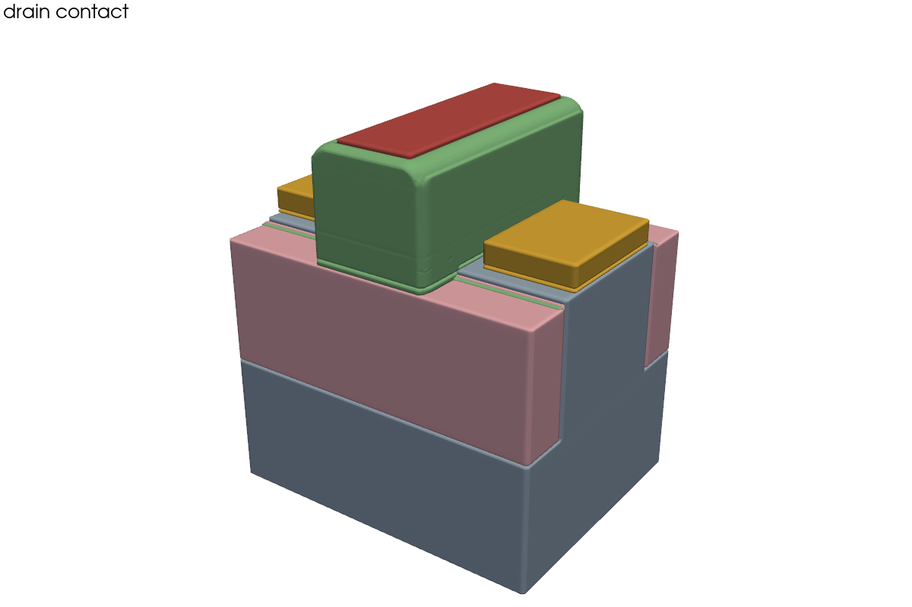
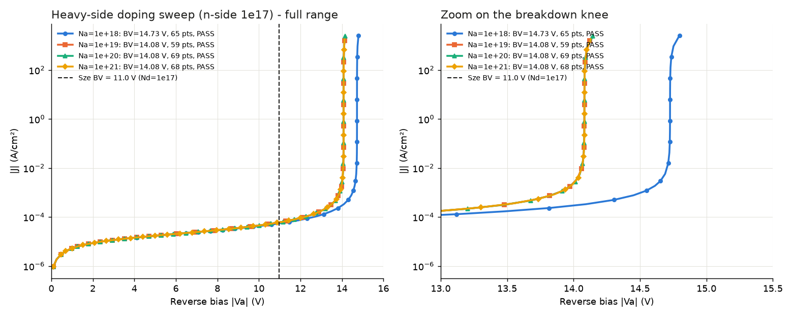

# gatorade_tcaddevice

TCAD-style semiconductor device simulators, built from scratch in
Python/NumPy/SciPy - started in 1D (formerly `tcad1d` / `1D-TCAD`), now 2D,
with 3D under way:

- **1D:** p-n junction diode (drift-diffusion, I-V, avalanche, TAT/BTBT
  leakage) and MOS capacitor (C-V).
- **2D:** diode, MOS capacitor and a planar NMOS transistor on a balanced
  square-quadtree mesh (non-obtuse by construction, refinement boxes,
  graded interface/junction refinement), solved with a coupled Newton
  box-method drift-diffusion solver (quasi-Fermi unknowns,
  Scharfetter-Gummel flux, velocity saturation).
- **3D (in progress):** a virtual fab that builds devices from a process
  flow (level sets on a voxel grid), starting with a planar MOSFET with STI,
  and the `tcadview` desktop viewer. The 3D solve is next.

<p align="center">
  
  
</p>

## 2D NMOS (`main2d_mosfet_sweep.py`, `configs/input_mosfet_2d.yaml`)

```bash
python3 main2d_mosfet_sweep.py      # Id-Vg at Vds=0.05/1 V + Id-Vd family, ~20 s
```

Runs every curve as an independent continuation in its own process and
extracts SS, Vt (constant-current and max-gm), DIBL and Ion/Ioff
(`solver2d/mosfet_metrics.py`). Mesh refinement boxes, interface/junction
spacing and `physics: velocity_saturation` are set in the YAML.

<p align="center">
  
</p>
<p align="center">
  
  
</p>

## 2D tunneling leakage: GIDL and junction BTBT (`btbt/`)

Band-to-band (Kane) and trap-assisted (Hurkx) tunneling in the 2D MOSFET,
both as the 1D local-field models and as a **nonlocal** model that traces
tunneling paths along electric field lines (a path exists only where the
bands actually bend by Eg; electrons and holes are generated at opposite
ends). Works across Si/SiGe heterojunctions (band-edge path conditions).

```bash
python3 -m btbt.main_btbt_1d --Na 1e18                         # 1D validation, local vs nonlocal
python3 -m btbt.main_btbt2d_sweep                               # NMOS Id-Vg (GIDL) + Id-Vsub (junction), 4 models
python3 -m btbt.main_btbt2d_sweep configs/input_pmos_2d_btbt.yaml --models none,nonlocal
python3 -m btbt.main_btbt2d_sweep configs/input_pmos_2d_btbt_sige.yaml --models none,nonlocal
python3 -m btbt.compare_pmos_sige                               # PMOS Si vs strained SiGe S/D
python3 -m btbt.gidl_ablation                                   # GIDL onset: EOT, metal gate, graded S/D
```

Outputs go to `out/btbt/`, including field-line / band-diagram figures
(`gidl_fields_bands.png`, `junction_fields_bands.png`) that show where and
why tunneling happens.

<p align="center">
  
</p>
<p align="center">
  
</p>

## 3D virtual fab (`fab/`, `configs/fab_planar.yaml`)

Builds a 3D device the way a fab does, one process step at a time, and
writes a snapshot after every step so you can scrub through the build.

`python3` in these commands means the project's environment. Run them from
`tcad1d/` after `source .venv/bin/activate`, or write `.venv/bin/python`
instead. A system `python3` (e.g. Homebrew's) has no PyVista/Qt and reports
"No module named tcadview". 3D solves (`fab simulate`) run faster in the
conda env with PETSc: `~/miniconda3/envs/tcad/bin/python`.

```bash
python3 -m fab build configs/fab_planar.yaml      # ~1.5 s build + ~2.5 s snapshots
python3 -m tcadview out/fab_planar/build.pvd      # "Process step" slider, colours by material
python3 -m fab expand configs/fab_planar.yaml     # the explicit, editable flow the template generates
```

<p align="center">
  
</p>

**The planar template** (`template: planar`) is a bulk NMOS or PMOS with a
finite width and STI on both sides:
1. substrate doping
2. STI trench, fill and CMP
3. well/Vt implant
4. gate dielectric over the whole flat surface, so the gate bottom is
   level over the channel and the STI alike
5. gate metal (TiN by default; `gate_material: Poly` also works), then a
   gate etch stopping on the dielectric
6. strip of the exposed gate dielectric only, which leaves the STI flush
   with the silicon (no recess step for the spacer to leave stringers in)
7. extension implant, self-aligned to the gate
8. nitride spacer (conformal deposit plus anisotropic etch)
9. source/drain implant, self-aligned to the gate and spacer
10. ILD fill and CMP to `ild_cap` above the gate, so dielectric (never
    gas) sits between the spacer and the contacts
11. contact trenches etched through the ILD only, filled with W up to the
    ILD top: whole metal volumes, taller than the gate (their sidewalls
    facing the gate are much of the off-state capacitance)

Every dimension is a parameter (`Lg`, `tox`, `spacer`, `W`, `sti_depth`,
the implant peaks and ranges, the voxel size, ...).

**The YAML has three layers.**
- Layer 1 is a template plus parameters.
- Layer 2 is the explicit process flow: what `fab expand` prints, editable,
  with every number an expression over the parameters (`"xg0 - spacer"`).
- Layer 3 is the device: contacts.

**How it works.**
- Each region is a level set on a uniform voxel grid.
- Each step is one geometric operation:
  - **conformal deposit:** an exact offset of the distance field, so
    corners round with the right radius
  - **fill and CMP**
  - **anisotropic etch:** a vertical sliding minimum of the gas visible
    from above, which keeps etched edges sub-voxel accurate and shadows
    overhangs
  - **isotropic etch**
  - **analytic implants:** Gaussian in depth, with a lateral erfc under
    mask and gate edges
- Distances are recomputed only when a step needs them, by a closest-point
  method that is exact on flat faces and about 0.02 nm on curved ones.
  Its inner loop is in Rust (`native/`), 7x faster than the numpy fallback.

**What is checked** (`testsuite/test_fab.py`):
- Each operation against analytic geometry: conformal corner radius,
  spacer width, etch stop, selective growth, implant depth and dose.
- The planar build against its own parameters: gate edges, oxide
  thickness, spacer width (8.000 nm for 8 nm), STI depth, the STI flush
  with the silicon, a flat gate bottom, and the junction depth against
  the Gaussians.
- **The viewer shows the device geometry exactly.** For a build, tcadview
  draws each material as the voxel faces the device is built from: sharp
  edges, and two materials share one face. The smooth level-set contours
  are a checkbox ("smooth surfaces"). They look nicer, but bevel every
  edge by up to a voxel and draw neighbouring materials as separate
  surfaces.
- **The structure check, after every build:** enclosed gas voids, detached
  fragments of a region, and layers one voxel thick are warnings in the
  build log. One-voxel flakes (the staircase of a curved surface poking
  out by a voxel) are relabelled to their surroundings and counted. A
  thin film between two different materials is never touched.
- A round trip through the layer-2 YAML.
- The snapshots in the viewer.

## Setup

Requires Python 3.9+ (any plain CPython install - no conda needed). Your
system `python3` almost certainly does NOT already have numpy/scipy/
matplotlib/pyyaml installed globally, so create a virtual environment first
rather than trying to run the scripts directly against system Python:

```bash
python3 -m venv .venv
source .venv/bin/activate        # Windows: .venv\Scripts\activate
pip install -r requirements.txt
python3 main.py                  # or any other script below
```

That's the only setup step - every script in this repo (`main.py`,
`mos/mos_main.py`, `avalanche/main_avalanche.py`, `mos/mos_poly_sweep.py`,
`avalanche/robustness_matrix.py`, `testsuite/test_examples.py`, ...) is
then runnable from the repo root, either directly with `python3
<path>/<script>.py` or (for anything inside the `core`/`mos`/`avalanche`
packages) as a module with `python3 -m <package>.<script>`, e.g. `python3
-m mos.mos_main`, no additional configuration, environment variables, or
install steps. All output (plots, CSVs, structure JSON) is written to
`out/<example>/` (e.g. `out/diode/`, `out/mos/`), which already exists in
the repo with the committed reference outputs - reruns just overwrite the
files for whichever example you ran.

To confirm everything works end to end after installing:

```bash
python3 testsuite/test_examples.py   # should print "OK" - 5 tests, no failures
python3 testsuite/test_2d_examples.py  # every bias point of the 4 2D drivers (~1.5 min)
python3 testsuite/test_vtk.py          # VTK export (also checks ParaView reads it, if installed)
python3 testsuite/test_native.py       # compiled kernels vs numpy (skipped if not built)
python3 testsuite/test_tcadview.py     # viewer, headless (skipped without the viewer deps)
python3 testsuite/test_fab.py          # virtual fab: operations vs analytic geometry, planar template
```

### Fast path (optional): PETSc solvers for 3D

The pip environment above runs everything, using METIS-ordered SuperLU
(`core/linsolve.py`). For 3D-sized problems, use the conda environment, which
adds PETSc point-block ILU-GMRES (about 20x faster than SuperLU on a real 3D
Jacobian):

```bash
conda env create -f environment.yml && conda activate tcad
python3 main2d_mosfet_sweep.py --extrude-um 0.1 --nz 6   # 3D extruded MOSFET, full I-V (~75 s)
```

Set `TCAD_LINSOLVE=superlu|umfpack|scipy_ilu|petsc_lu|petsc_ilu` to force a
backend (default `auto`: SuperLU below 60k unknowns, PETSc ILU above). The
3D roadmap and measured performance are in `plans/3d_plan.md`.

### Compiled kernels (optional, Rust)

Hot loops that numpy can't vectorize well have a Rust version in `native/`.
So far that is the nonlocal-tunneling field-line tracer, about 8x faster
than numpy, which cuts each nonlocal BTBT curve from ~43 s to ~26 s.
Everything runs without it: `core/native.py` falls back to numpy when the
extension isn't installed, and `TCAD_NATIVE=0` forces the fallback.

```bash
curl --proto '=https' --tlsv1.2 -sSf https://sh.rustup.rs | sh -s -- -y   # Rust toolchain
pip install maturin
cd native && maturin develop --release && cd ..   # builds into the active env
python3 testsuite/test_native.py                    # compiled vs numpy, to round-off
```

If both a venv and conda are active, maturin refuses to guess. Unset one
first (for example `env -u CONDA_PREFIX maturin develop --release`).

### Viewing results in ParaView (VTK export)

The 2D drivers take `--vtk` and write `<out-dir>/vtk/*.vtu` plus a `.pvd`
collection whose time axis is the swept bias:

```bash
python3 main2d_sweep.py --vtk                 # diode: the saved bias points
python3 main2d_mos_sweep.py --vtk             # MOS-cap: the saved gate voltages
python3 main2d_mosfet_sweep.py --vtk          # MOSFET: last point of each curve
python3 main2d_mosfet_sweep.py --vtk all      # every bias point (~0.5 MB each in 2D, ~3 MB in 3D)
```

The files are self-contained:
- **Point fields** use Sentaurus-style names: `ElectrostaticPotential`,
  `eDensity`/`hDensity`, quasi-Fermi potentials and energies, band edges,
  `DopingConcentration`, `SpaceCharge`, and `contact_id`.
- **Cell fields:** `region_id`, `material_id` and `ElectricField`.
- **Field data:** region, material and contact names, plus contact biases.

Carrier quantities are NaN in insulators. y is depth, positive downward, so
in ParaView look from -z with view-up (0, -1, 0). The writer is pure numpy
(`core/vtk_io.py`), so nothing extra needs installing.

### tcadview: desktop viewer (optional)

`tcadview` opens the same `.vtu`/`.pvd` files in a Qt window:

```bash
pip install -r requirements-viewer.txt          # PySide6, pyvista, pyvistaqt (already in environment.yml)
python3 main2d_mosfet_sweep.py --vtk all
python3 -m tcadview out/input_mosfet_2d/vtk/idvg_Vds0.05.pvd
python3 -m tcadview result.pvd --field eDensity --state -1 --screenshot shot.png   # headless
```

What it does:
- **Regions panel:** region/material tree with show/hide and per-region
  opacity.
- **Field controls:** field picker with linear, log or signed-log scale,
  auto or manual range, colormap choice and mesh edges. Densities and
  doping default to log scales.
- **Slices (3D):** x/y/z slice planes with sliders. Region outlines stay
  visible while slicing.
- **Probe:** right-click a point to list every field there and its region.
- **Cut line:** type two points or pick them with right-clicks. The 1D
  panel plots the field along the line and follows the bias stepper.
- **Bias stepper:** for a sweep, a slider and prev/next buttons. The
  camera, field and cut line are kept as you step.
- **Section view (3D):** Slices > Section view shows an x/y/z slice
  face-on in a second, 2D view. Right-click probes inside the device. H cut
  and V cut run a cut line through the last clicked point, and Overlay
  curves keeps earlier curves to compare bias points.
- **Process steps:** a virtual-fab build (`fab/`) opens on its final
  structure, with a "Process step" slider. The Material field colours
  each region by its material. Region surfaces are smooth contours of the
  level sets, and the region list grows as layers are added.

The device is drawn the right way up (y is depth). `testsuite/test_tcadview.py`
drives the window headless.

## Diode (`main.py`, `configs/input_diode.yaml`)

- Builds a nonuniform 1D mesh across a step p-n junction (sub-nm spacing at
  the junction, geometrically coarsening into the bulk).
- Solves the **equilibrium** nonlinear Poisson equation (Newton's method) for
  the self-consistent built-in potential and space-charge profile.
- Solves the **biased** drift-diffusion system (Poisson + electron/hole
  continuity, Scharfetter-Gummel discretization), sweeping applied voltage
  forward and reverse, using either of two interchangeable solvers:
  - **Gummel iteration**: decoupled, robust, linear convergence (many outer
    iterations).
  - **Coupled Newton**: all three equations (Poisson + both continuity
    equations) solved together with an analytic sparse Jacobian and a direct
    sparse solve per step, quadratic convergence (few outer iterations,
    ~4-10x faster wall-clock depending on bias range - see
    `out/diode/06_solver_benchmark.png`).
- Compares against closed-form theory: built-in potential
  `Vbi = Vt*ln(Na*Nd/ni^2)`, the depletion approximation, and the Shockley
  long-base ideal diode law `I = I0*(exp(V/Vt)-1)`.
- Plots the electron/hole quasi-Fermi potentials (phin, phip) at a
  configurable set of bias points (`input_diode.yaml`: `output.save_bias_points`),
  alongside a full-field CSV export for those points.

All simulation parameters (doping, device thickness, mesh knobs, voltage
sweep range, which solver to use, which bias points to save full fields
for) are read from `input_diode.yaml`, not hardcoded - edit that file to
change them. `params.py` just holds the defaults it overrides. Doping on
either side can be `flat` (uniform), `linear` (graded), or `gaussian`
(implant-like) - see the comments in `input_diode.yaml` for the schema; the
mesh (`mesh.py`) automatically refines wherever a graded profile changes
quickly, not just at the junction.

```bash
python3 main.py
```

### Diode results

- The numerically self-consistent built-in potential matches
  `Vt*ln(Na*Nd/ni^2)` to 8 significant figures.
- The equilibrium potential profile matches the depletion approximation,
  with the expected smoothing (over a Debye length) at the depletion edges
  that the depletion approximation idealizes as abrupt.
- The extracted ideality factor rises toward n≈1.85 near the recombination
  peak (SRH recombination in the depletion region dominates at low forward
  bias) and relaxes toward n≈1 at higher forward bias (bulk diffusion
  current dominates) — the textbook two-regime diode I-V curve:

  
- Reverse leakage current is orders of magnitude above the ideal Shockley
  I0, correctly reflecting depletion-region generation current that the
  simple long-base ideal-diode formula does not model.
- Beyond the numeric-vs-analytic comparisons above, every run also writes a
  `*_structure.json` (device geometry, mesh, doping, per-bias fields - see
  `structure_io.py`; the filename is set by `input_diode.yaml`'s
  `output.structure_file`, or `null` to skip writing it) that `plot.py`
  turns into textbook-style diagrams: the device cross-section with mesh
  node density visible, a real Ec/Ev/Ei/Ef band diagram (not just
  electrostatic potential), and a fixed/mobile/net charge-density
  decomposition - either automatically as part of `main.py`/`mos_main.py`,
  or standalone later against just the JSON file, with individual
  curves toggleable:
  ```bash
  python3 core/plot.py out/diode/diode_structure.json                     # all three plots, all curves
  python3 core/plot.py out/diode/diode_structure.json --which bands --band-fields Ec,Ev,Ef
  python3 core/plot.py out/diode/diode_structure.json --interactive          # one window, all fields loaded, click to toggle
  ```

  
- The coupled Newton solver matches Gummel's current to 4+ significant
  figures at every bias point while using far fewer outer iterations
  (quadratic vs. linear convergence); the speedup grows with how hard the
  bias point is to converge (~4x over a mild 0.65V forward sweep, ~10x once
  the sweep is pushed to 1.2V/high injection, where Gummel starts hitting
  its iteration cap without fully converging - see `DEVELOPMENT_LOG.md`).

All simulation parameters for both tools are read from their `input_*.yaml`
file, not hardcoded - `params.py`/`mos_params.py` just hold the defaults
those files override. The two YAML files use a deliberately parallel
schema (`doping`, `mesh`, `voltage_sweep`, `output` sections) even though
the tools don't yet share a single "device stack" description - see
`mesh.py`'s module docstring for what they do share (the mesh engine
itself and the doping-profile machinery in `doping_profiles.py`).

## Avalanche breakdown (`avalanche/`, `configs/input_diode_breakdown.yaml`)

```bash
python3 -m avalanche.main_avalanche        # 1e19/1e17 diode traced through breakdown, ~2 s
python3 -m avalanche.robustness_matrix     # 8 devices x 4 meshes, pass/fail per run, ~1 min
```

Impact ionization (van Overstraeten-de Man) in both continuity equations,
driven by a density-weighted blend of the quasi-Fermi gradient and the
electric field. The reverse I-V is traced **through** the near-vertical
breakdown knee with arc-length continuation in the (Va, ln|J|) plane
(`core/arclength.py`), so there is no bias schedule to tune. It holds up
from 1e17 to 1e21 doping on either side, with flat, Gaussian or graded
profiles and meshes as coarse as ~50 nodes. `main_avalanche.py` checks the
result against the no-avalanche solve (multiplication factor), Sze's and
Miller's closed forms, and the ionization integral on the solver's own field
at the numeric breakdown voltage (~1, as it should be).

<p align="center">
  
</p>
<p align="center">
  
</p>

## MOS capacitor (`mos/mos_main.py`, `configs/input_mos.yaml`)

- Builds a mesh across a metal gate - thin oxide - uniform substrate stack
  (either p- or n-type; generic to pMOS-cap or nMOS-cap).
- A MOS capacitor has **no current path** in steady state (the gate is an
  ideal insulator), so at every DC gate voltage the structure sits at a
  single, uniform Fermi level - the **low-frequency (quasi-static) C-V
  curve** needs only a sequence of equilibrium nonlinear-Poisson solves
  (reusing the diode's `solve_poisson`, generalized to a position-dependent
  permittivity and intrinsic concentration for the oxide/semiconductor
  stack), no continuity equations or AC analysis at all:
  `C(V_G) = -dQ_gate/dV_G` from numerically differentiating the swept
  charge.
- The **high-frequency C-V curve** (inversion/minority charge can't follow
  a fast probe signal) is a **quasi-small-signal** calculation, not a
  literal frequency-domain solve: freeze the minority carrier
  (`solve_poisson`'s `n_frozen` for a p-substrate, `p_frozen` for an
  n-substrate) at its low-frequency value, perturb V_G by a small amount,
  and let only the majority carrier and potential respond.
- Compares against closed-form depletion-approximation theory: flat-band
  voltage (computed from an explicit, physically real gate work function -
  `input_mos.yaml`: `gate.workfunction_eV`, or `null` for the ideal
  phi_ms=0 assumption), threshold voltage, and analytic low-/high-frequency
  C-V curves.
- Oxide thickness, oxide permittivity, substrate doping (`flat`/`linear`/
  `gaussian` - e.g. a shallow threshold-adjust implant right under the
  gate), and every mesh knob are all read from `input_mos.yaml`, not
  hardcoded.

```bash
python3 -m mos.mos_main
```

### MOS-cap results

- The numeric C-V curve reproduces the textbook shape exactly: accumulation
  (C→C_ox), depletion (matches the analytic depletion approximation
  closely), and the classic **low-frequency/high-frequency split** in
  inversion (low-freq rises back toward C_ox as the inversion layer forms
  and can respond; high-freq stays pinned near C_min since it can't):

  
- In accumulation, the numeric result converges (confirmed via a mesh
  refinement study) to ~0.84 x C_ox rather than the idealized analytic
  C_ox - a real, finite accumulation-layer screening-length effect the
  simple depletion approximation doesn't capture, requiring a much finer
  near-interface mesh than the depletion region needs to resolve properly.
- Verified generic to both substrate types: for the same 1e16 cm^-3
  doping, threshold voltage comes out at +0.728V for a p-substrate and the
  mirror-image -0.728V for an n-substrate, with the accumulation/depletion/
  inversion regions correctly swapping which side of V_FB they fall on.
- Also gets the `plot.py` structure/band/charge diagrams described above
  (see the diode section) - the MOS-cap band diagram shows the ~3.15 eV
  Si/SiO2 conduction-band offset (from each material's own electron
  affinity, via `mos_params.py`'s approximate SiO2 constants) come out
  correctly, and the charge-density plot is labeled with the
  accumulation/depletion/inversion regime at each saved gate voltage.

  

## Files

| File | Purpose |
|---|---|
| `configs/input_diode.yaml` | **Edit this** for the diode: doping (flat/linear/gaussian per side), thickness, mesh knobs, voltage sweep, solver (`math_model: gummel` \| `newton`), which bias points to save fields for |
| `core/config.py` | Loads `configs/input_diode.yaml` into `Material`/`Device`/voltage-sweep/solver-choice/mesh overrides |
| `configs/input_mos.yaml` | **Edit this** for the MOS capacitor: substrate polarity/doping (flat/linear/gaussian), oxide thickness/permittivity, gate work function, mesh knobs, voltage sweep |
| `mos/mos_config.py` | Loads `configs/input_mos.yaml` into `Material`/`MOSDevice`/voltage-sweep/mesh overrides |
| `core/doping_profiles.py` | Shared doping-profile shapes (flat/linear/gaussian) and their sampling/reference-concentration logic, used by both YAML files and both mesh builders |
| `core/params.py` | Physical constants and diode material/device parameter defaults |
| `mos/mos_params.py` | MOS capacitor device parameters (oxide thickness, gate work function, SiO2 permittivity) |
| `core/mesh.py` | Shared mesh engine (`build_diode_grid`, `build_mos_grid`): geometric refinement at hard interfaces plus adaptive refinement wherever a graded doping profile changes quickly |
| `core/physics.py` | Bernoulli function (+ its derivative), nonlinear Poisson (Newton, generalized to array eps/ni and frozen-carrier modes), Scharfetter-Gummel continuity solves |
| `core/analytic.py` | Diode closed-form comparisons (Vbi, depletion width, Shockley law) |
| `mos/mos_analytic.py` | MOS-cap closed-form comparisons (flat-band/threshold voltage, analytic low-/high-freq C-V) |
| `core/solver.py` | Diode equilibrium solve + bias sweep (dispatches to either solver below) |
| `core/newton_solver.py` | Diode's fully coupled Newton solve: analytic sparse Jacobian, direct sparse solve, backtracking line search |
| `mos/mos_solver.py` | MOS-cap equilibrium C-V sweep (low-frequency) and frozen-carrier quasi-small-signal sweep (high-frequency) |
| `core/field_save.py` | Shared helper: selecting which bias points to save full field profiles for, quasi-Fermi-potential plotting, field CSV export |
| `core/structure_io.py` | Schema + save/load for the `*_structure.json` files each driver writes: device geometry, mesh, doping, and per-bias fields, in one human-readable file `plot.py` (or a future 2D/3D version of this project) can read back |
| `core/plot.py` | Structure/band-diagram/charge-density plot library, driven from a loaded structure file. Also runnable standalone against just a `*_structure.json`: `python3 core/plot.py out/diode/diode_structure.json --interactive` opens one window with every plot and field already loaded, click a checkbox to toggle a curve; `--which`/`--band-fields`/`--charge-fields` narrow down what gets drawn (in either interactive or plain PNG mode) |
| `main.py` | Diode driver: runs the sweep with both solvers (for the benchmark) plus the one from `configs/input_diode.yaml`, generates plots and CSVs in `out/diode/` |
| `mos/mos_main.py` | MOS-cap driver: runs the C-V sweep, generates plots and CSVs in `out/mos/` (or `out/mos_poly/` for a poly-gate input) |

Requires `numpy`, `scipy`, `matplotlib`, `pyyaml`. Output plots and CSVs are
written to `out/<example>/` (a separate subfolder per example; filenames don't collide).
