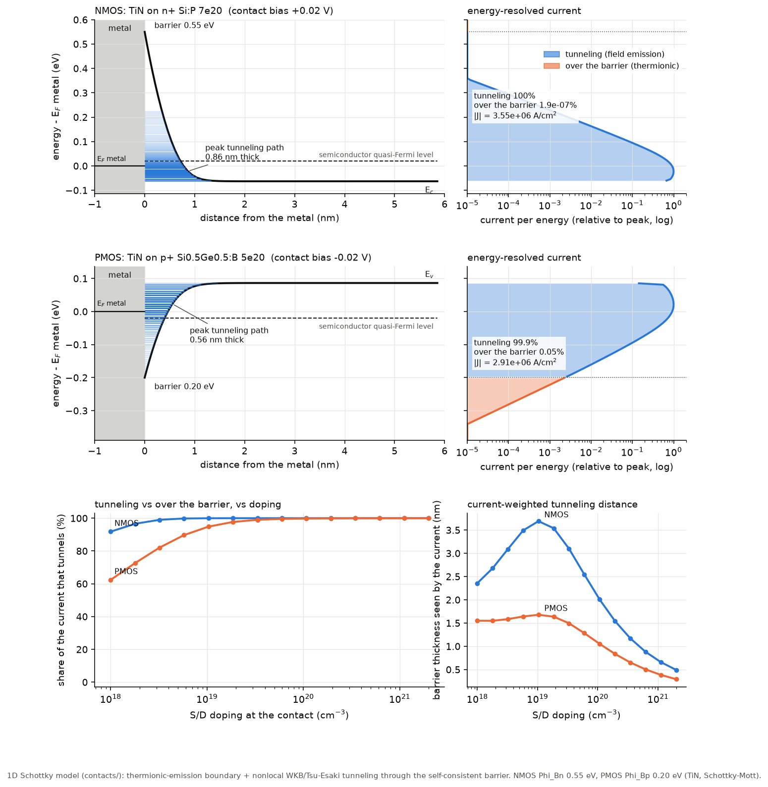
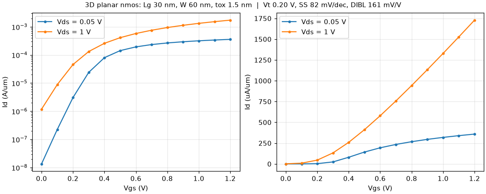
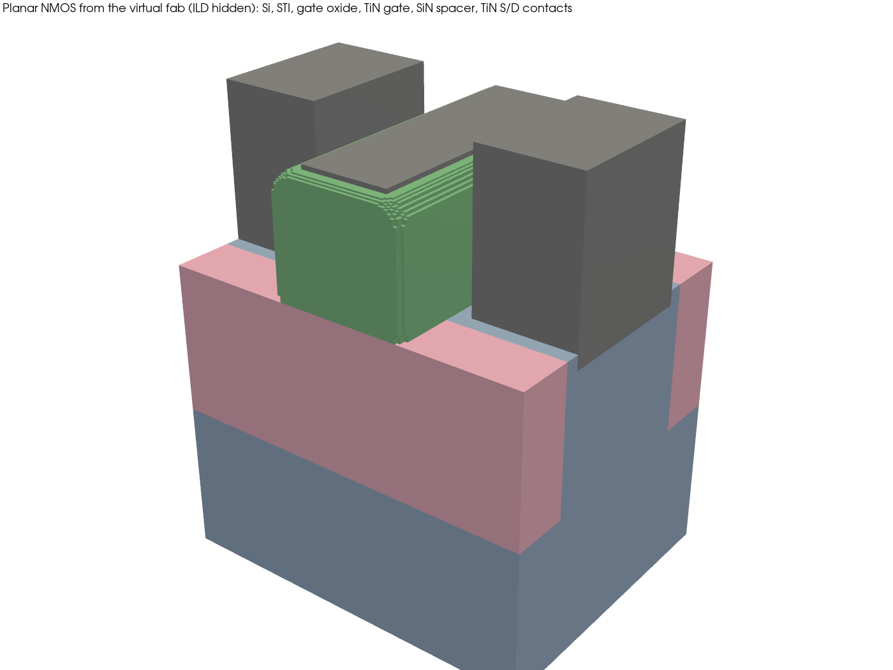
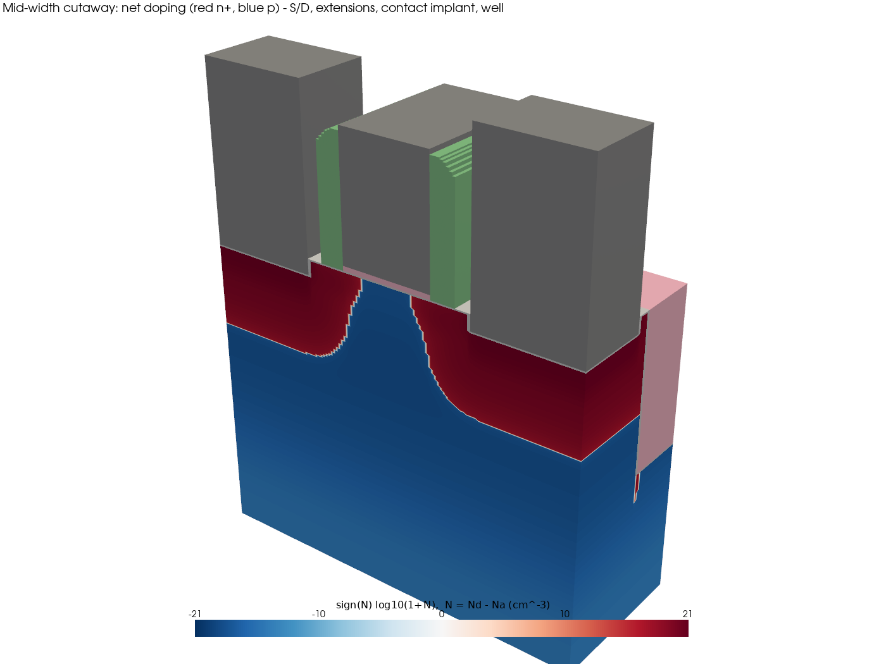
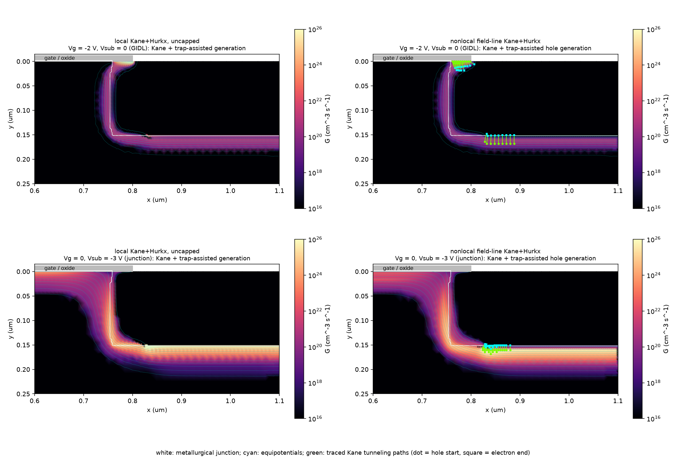
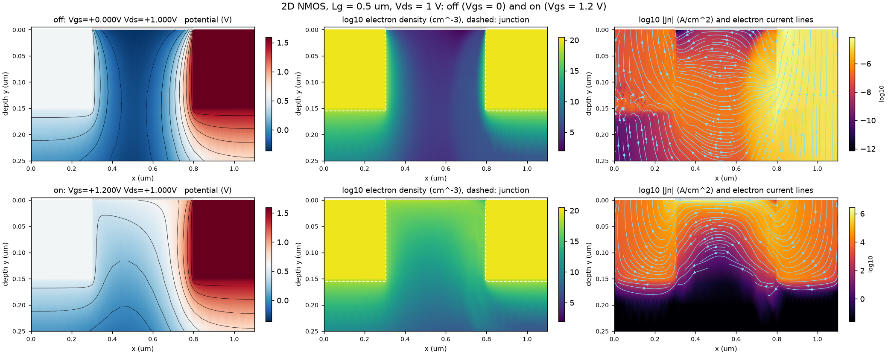
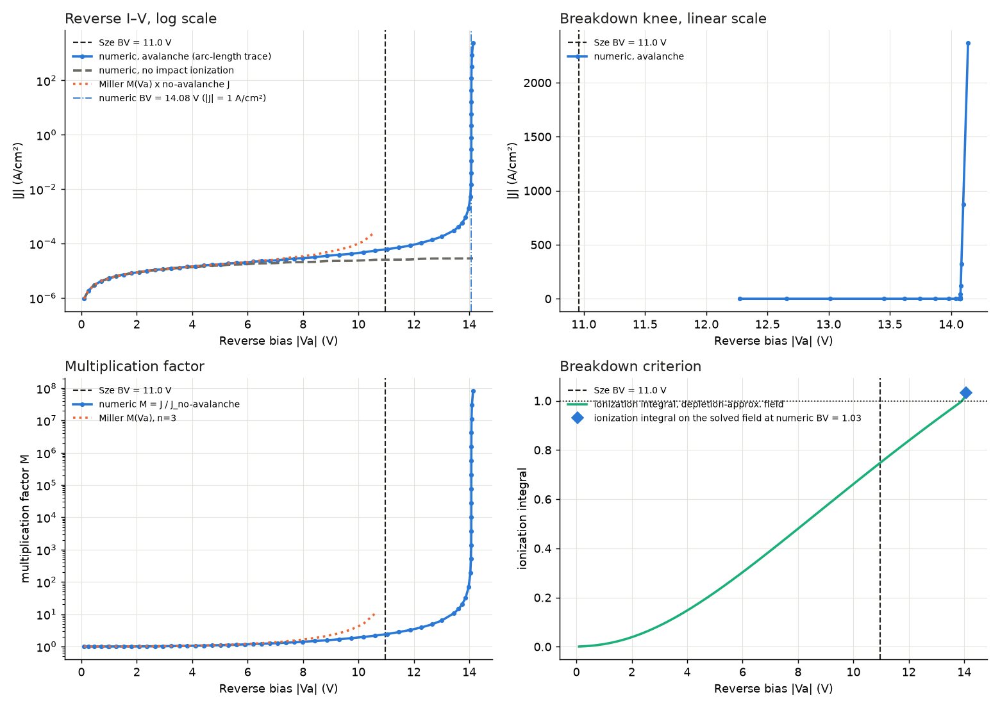

# gatorade_tcaddevice

TCAD device simulators built from scratch in Python/NumPy/SciPy (hot loops
in Rust): 1D, then 2D, now 3D. Newest work first; each section links to
its details.

## 3D planar NMOS: Schottky S/D contacts ([details](docs/schottky.md))

The S/D metal/semiconductor contact is modeled with thermionic emission
plus WKB tunneling through the solved barrier. In 2D/3D the barrier is a
sub-grid boundary condition, and it is on by default.

```math
J=\frac{A^{*}T}{k_B}\int \mathcal{T}(E)\,\ln\frac{1+e^{(E_{F,s}-E)/k_BT}}{1+e^{(E_{F,m}-E)/k_BT}}\,dE,
\qquad
\mathcal{T}(E)=\exp\!\Big(-\frac{2}{\hbar}\int_{0}^{x_t}\sqrt{2m^{*}\,(E_c(x)-E)}\,dx\Big)
```

<p align="center">
  
</p>

## 3D planar NMOS: device solve ([details](docs/fab.md))

Coupled Newton drift-diffusion on an octree mesh with Schottky contacts.
A full Id-Vg takes 74 s: Ion 1729 uA/um, SS 82 mV/dec, DIBL 161 mV/V.
Run it with `python -m fab simulate configs/fab_planar.yaml --mesher octree`.

```math
\nabla\!\cdot(\varepsilon\nabla\psi)=-q\,(p-n+N_D^{+}-N_A^{-}),\qquad
\nabla\!\cdot\mathbf J_n=qR,\qquad
\mathbf J_n=-q\,\mu_n(F)\,n\,\nabla\phi_n,\qquad
\mu_n(F)=\frac{\mu_0}{\big[1+(\mu_0F/v_{sat})^{\beta}\big]^{1/\beta}}
```

<p align="center">
  
</p>

## 3D virtual fab ([details](docs/fab.md))

The fab builds the device one process step at a time on voxel level sets:
STI, gate, spacer, implants, ILD and contacts. The images show the exact
voxel faces the solver meshes. Build it with
`python -m fab build configs/fab_planar.yaml`.

```math
N(\mathbf r)=\frac{\Phi}{\sqrt{2\pi}\,\Delta R_p}\exp\!\Big(-\frac{(d_{\rm surf}-R_p)^2}{2\Delta R_p^2}\Big)\cdot
\tfrac12\,\mathrm{erfc}\!\Big(\frac{d_{\rm mask}}{\sqrt2\,\sigma_{\rm lat}}\Big)
```

<p align="center">
  
  
</p>

## 2D GIDL and junction BTBT ([details](docs/2d.md))

Kane band-to-band and Hurkx trap-assisted tunneling, evaluated along
tunneling paths traced through the 2D field: nonlocal, and correct across
Si/SiGe.

```math
G_{\rm BTBT}=A\,F_{\rm eff}^{P}\exp\!\Big(-\frac{B}{F_{\rm eff}}\Big),\qquad F_{\rm eff}=\frac{E_g}{q\,\ell_{\rm path}}
```

<p align="center">
  
</p>

## 2D NMOS ([details](docs/2d.md))

Box-method drift-diffusion with Scharfetter-Gummel fluxes on a
non-obtuse quadtree mesh. Run it with `python3 main2d_mosfet_sweep.py`
(about 10 s).

```math
J_{n,ij}=\frac{q\,\mu_n V_T}{h_{ij}}\Big[n_j\,B\!\Big(\frac{\psi_j-\psi_i}{V_T}\Big)-n_i\,B\!\Big(\frac{\psi_i-\psi_j}{V_T}\Big)\Big],\qquad B(x)=\frac{x}{e^{x}-1}
```

<p align="center">
  
</p>

## 1D avalanche breakdown ([details](docs/1d.md))

The reverse I-V is traced through the breakdown knee by arc-length
continuation. Run it with `python3 -m avalanche.main_avalanche`.

```math
G_{II}=\frac{\alpha_n|\mathbf J_n|+\alpha_p|\mathbf J_p|}{q},\qquad \alpha(F)=a\,e^{-b/F},\qquad \int_0^W\!\alpha\,dx=1\ \text{at } BV
```

<p align="center">
  
</p>

## 1D diode and MOS capacitor ([details](docs/1d.md))

These were the first two devices: a p-n diode I-V (Gummel or coupled
Newton) and MOS C-V (quasi-static and high frequency). Run them with
`python3 main.py` and `python3 -m mos.mos_main`.

```math
\frac{d}{dx}\Big(\varepsilon\frac{d\psi}{dx}\Big)=-q\big(p_0e^{-\psi/V_T}-n_0e^{\psi/V_T}+N_D-N_A\big),\qquad C(V_G)=\frac{dQ_G}{dV_G}
```

<p align="center">
  
  
</p>

## Setup ([details](docs/setup.md))

```bash
python3 -m venv .venv && source .venv/bin/activate
pip install -r requirements.txt
python3 testsuite/run.py           # parallel quick tier, ~70 s
```

3D solves run faster in the conda env with PETSc (`environment.yml`). The
viewer is `python3 -m tcadview <file.pvd>`. `python3
docs/make_readme_figures.py` regenerates the images in `docs/img/`. For
the code layout see [ARCHITECTURE.md](ARCHITECTURE.md),
[docs/files.md](docs/files.md) and [DEVELOPMENT_LOG.md](DEVELOPMENT_LOG.md).
