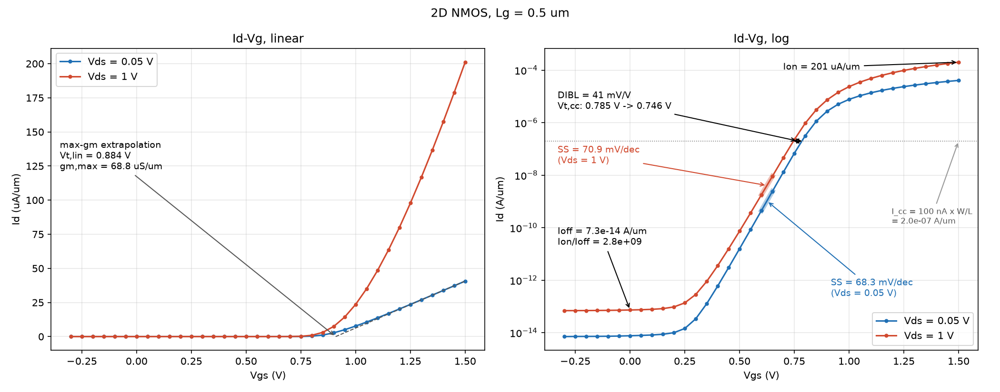
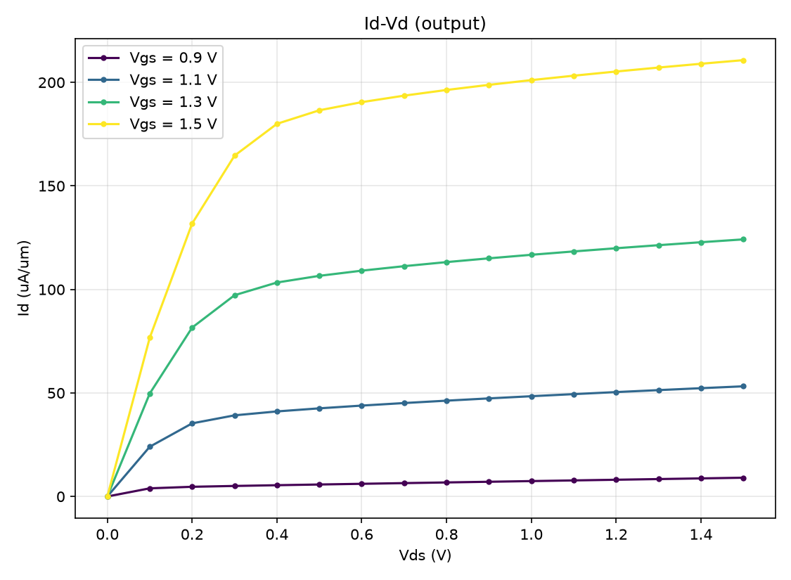
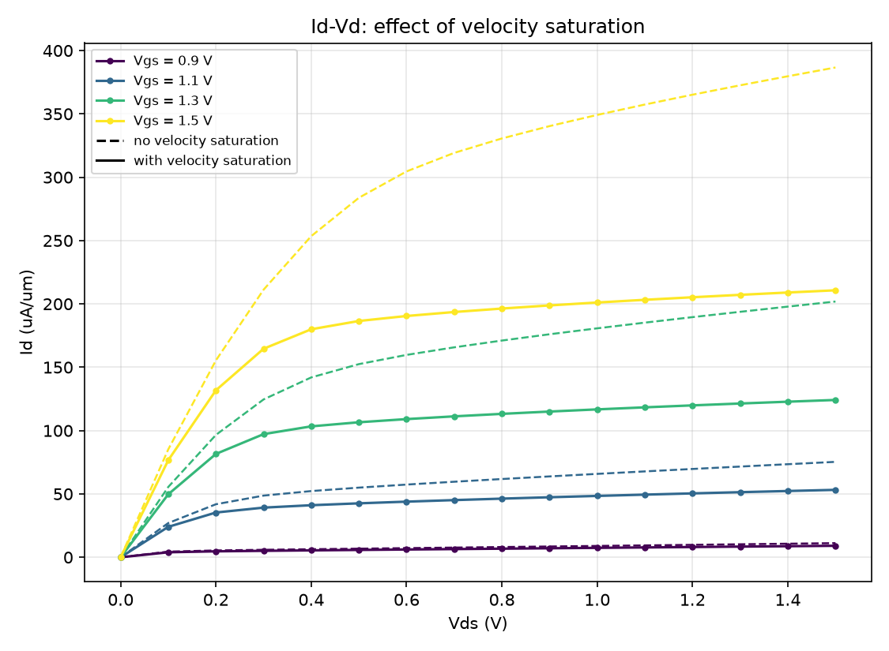
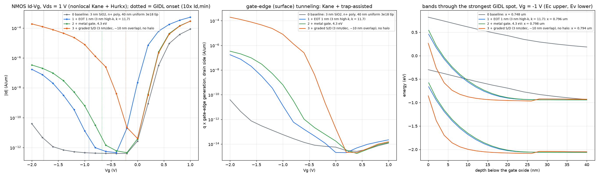
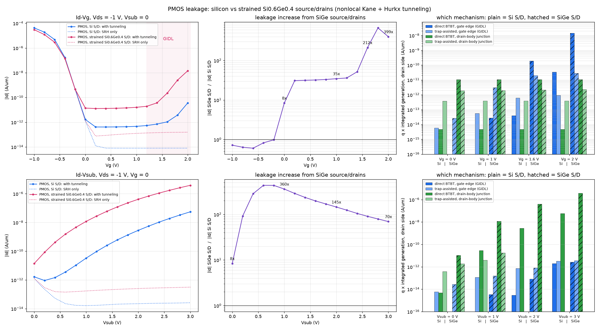

# 2D devices: details

[Back to the README](../README.md)

## 2D NMOS (`main2d_mosfet_sweep.py`, `configs/input_mosfet_2d.yaml`)

```bash
python3 main2d_mosfet_sweep.py      # Id-Vg at Vds=0.05/1 V + Id-Vd family, ~20 s
```

Runs every curve as an independent continuation in its own process and
extracts SS, Vt (constant-current and max-gm), DIBL and Ion/Ioff
(`solver2d/mosfet_metrics.py`). Mesh refinement boxes, interface/junction
spacing and `physics: velocity_saturation` are set in the YAML.

<p align="center">
  
</p>
<p align="center">
  
  
</p>

## 2D tunneling leakage: GIDL and junction BTBT (`btbt/`)

Band-to-band (Kane) and trap-assisted (Hurkx) tunneling in the 2D MOSFET,
both as the 1D local-field models and as a **nonlocal** model that traces
tunneling paths along electric field lines (a path exists only where the
bands actually bend by Eg; electrons and holes are generated at opposite
ends). Works across Si/SiGe heterojunctions (band-edge path conditions).

```bash
python3 -m btbt.main_btbt_1d --Na 1e18                         # 1D validation, local vs nonlocal
python3 -m btbt.main_btbt2d_sweep                               # NMOS Id-Vg (GIDL) + Id-Vsub (junction), 4 models
python3 -m btbt.main_btbt2d_sweep configs/input_pmos_2d_btbt.yaml --models none,nonlocal
python3 -m btbt.main_btbt2d_sweep configs/input_pmos_2d_btbt_sige.yaml --models none,nonlocal
python3 -m btbt.compare_pmos_sige                               # PMOS Si vs strained SiGe S/D
python3 -m btbt.gidl_ablation                                   # GIDL onset: EOT, metal gate, graded S/D
```

Outputs go to `out/btbt/`, including field-line / band-diagram figures
(`gidl_fields_bands.png`, `junction_fields_bands.png`) that show where and
why tunneling happens.

<p align="center">
  
</p>
<p align="center">
  
</p>
