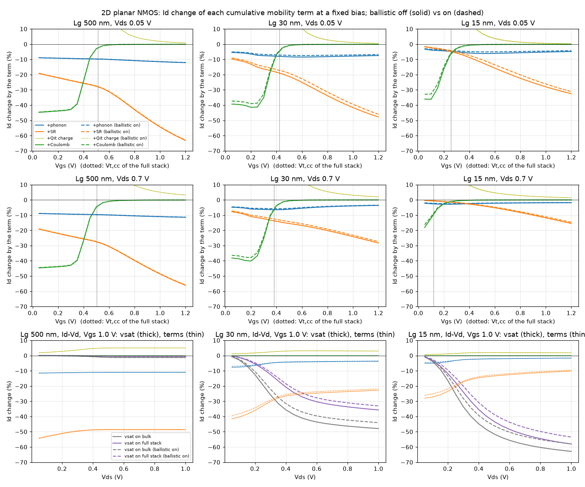
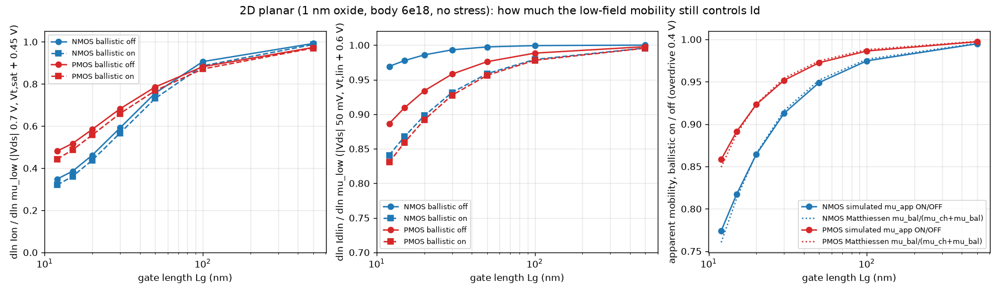

# Ballistic (channel-length) mobility

In a channel a few mean free paths long, part of the carriers cross it
without scattering, and drift-diffusion with the long-channel mobility no
longer holds. The quasi-ballistic correction used by Sentaurus (BalMob) and
by Shur adds a channel-length "ballistic mobility" by Matthiessen's rule.
It is **ON by default** since DEVELOPMENT_LOG 86 (`--ballistic off` or
`ballistic: false` turns it off). It fades as 1/Lg, so long channels are unchanged.

## The model

```
1/mu0 = 1/mu_low + w / (gamma^s * mu_bal)          per edge, low field (before velocity saturation)
mu_bal = q v_T L_ch / (2 k T),   v_T = sqrt(2 k T / (pi m*))
```

- **mu_low** is the low-field mobility after the whole pipeline before it:
  bulk -> surface/Coulomb (docs/mobility.md) -> edge mean -> stress (piezo,
  docs/piezo_mobility.md). The ballistic term comes next, then velocity
  saturation (`low_field_mobility`, step 5, in solver2d/newton_solver_qf_2d.py).
- **v_T** is the unidirectional thermal velocity of a non-degenerate 2D gas.
  m* is the transport mass along the channel: 0.19 m0 for electrons (the
  Δ2 transverse mass on (001)) and 0.40 m0 for unstrained holes. So
  k = mu_bal / L_ch = 23.9 (n) and 16.4 (p) cm²/(V s nm). Sentaurus uses
  20 for both, and Monte Carlo gives 8-13 (below).
- **Why Matthiessen.** In Lundstrom's linear-regime backscattering model,
  r = L/(L + λ) with λ = 2 (kT/q) μ / v_T, so the apparent mobility
  μ_app = L G /(W Q) is exactly 1/μ + 1/μ_bal (tested to 1e-10,
  `test_lundstrom_identity`). The term only ever LOWERS the mobility. It
  cannot add current.
- **gamma** is the piezo stress factor of the edge alone
  (`mesh.edge_mu0_factors['stress']`), with s = 0.5 (`stress_exp`). A
  mass-driven mobility gain γ raises v_T by about sqrt(γ), not γ: holes gain
  about 2x in injection velocity for about 4x in mobility (Khakifirooz,
  literature section). Other static factors do not scale μ_bal.
- **w** is the channel mask: 1 on semiconductor edges inside the gate
  window (x within the gate, tanh edges 1 nm wide) whose doping is below
  3e19 (smooth in log N). It is 0 in the S/D, in the insulators and away
  from the gate. The S/D and the deep body are not ballistic channels.
- **L_ch** is the gate length: the template's Lg on fab devices, and the
  gate contact's length in 2D (`L_nm` overrides it).
- **Placement.** `lowfield` (the default) is Sentaurus'
  `DopingDependence(BalMob)`: Matthiessen into mu0, before velocity
  saturation. `total` is Sentaurus `Mobility(BalMob)`, Eq. 367: Matthiessen
  with the field-dependent mobility. In `total` the vsat partials scale by
  (μ/μ_DD)² (the Jacobian is checked against finite differences for both
  placements and every vsat force).
- mu_bal does not depend on the solution, so it costs nothing per Newton
  step and the Jacobian is unchanged.

## How to use it

- 3D fab: `python -m fab simulate <cfg> --ballistic [--ballistic-k K]
  [--ballistic-placement lowfield|total]`.
- 2D: a `ballistic:` block in a `main2d_mosfet_sweep` config (`enabled:
  true`, plus any of `L_nm`, `k`, `k_n`, `k_p`, `m_n`, `m_p`, `stress_exp`,
  `n_max_cm3`, `smooth_nm`, `margin_nm`, `placement`), or `--ballistic
  on|off` on the command line.
- Off is bit-identical to a mesh without the term (tested).

## Results

### B1. Gate-length sweep, FinFET (the acceptance test)

`scripts/ballistic/finfet_sweep.py`: configs/fab_finfet{,_pmos}.yaml with
Lg 12-30 nm and cpp = Lg + 33 nm (the spacers, S/D epi and contacts keep
their size), octree, fast vsat, the default mobility stack (Qit 3e11 on the
gate dielectric). Ion is at |Vgs - Vt,sat| = 0.45 V, |Vds| 0.7 V, Vt,sat by
constant current 100 nA·W/L, in uA/um. Results in
out/ballistic_finfet2 (main checkout).

**NMOS** (no stress; the theory k_n = 23.9, μ_bal = 287-717 cm²/Vs):

| Lg (nm) | Ion off | Ion ballistic on | change | Idlin off / on | Vt,sat off / on (V) | DIBL off / on (mV/V) |
|---|---|---|---|---|---|---|
| 12 | 472 | 458 | -3.0% | 136 / 123 | 0.056 / 0.070 | 179 / 180 |
| 15 | 574 | 549 | -4.4% | 134 / 121 | 0.145 / 0.155 | 75 / 80 |
| 20 | 618 | 588 | -4.9% | 130 / 118 | 0.190 / 0.199 | 26 / 32 |
| 30 | 591 | 561 | -5.0% | 121 / 111 | 0.205 / 0.216 | 7 / 10 |

| NMOS | Ion(15)/Ion(30) (<= 1.05) | Ion(12)/Ion(15) (<= 1.03) |
|---|---|---|
| ballistic off | 0.972 | 0.822 |
| ballistic on | **0.979 PASS** | **0.834 PASS** |
| ballistic on, k = 8.4 (Monte Carlo); with stress | 0.992; 0.995 | - |

**The NMOS acceptance passes, but not because of the ballistic term.**
It passes with the term off too. Plan 4.3 asks for this to be stated
explicitly. The FinFET NMOS Ion is already flat in Lg in drift-diffusion
because of three things:
- the S/D series resistance (Schottky contact, fixed epi);
- velocity saturation;
- below 20 nm, electrostatics: Vt,sat rolls off 0.205 -> 0.056 V, DIBL
  goes 7 -> 179 mV/V, and the turn-on degrades, so Ion at a fixed
  overdrive peaks at 20 nm and falls at 15 and 12 nm.

The ballistic term costs 3-5% of Ion and 8-10% of Idlin at every Lg. Its
own Lg trend (-5.0% at 30 nm, -4.4% at 15) is smaller than the
electrostatic one. Idlin still rises 121 -> 136 uA/um from 30 to 12 nm
without the term, and 111 -> 123 with it: the ballistic term does not
flatten it.

**PMOS** (theory k_p = 16.4, μ_bal = 197-493 cm²/Vs; "stress" = the
fab_stress SiGe S/D field with the piezo factor, γ^0.5 scaling μ_bal):

| Lg (nm) | channel σxx (MPa) | Ion off | ballistic on | stress | stress + ballistic | stress gain, ballistic on |
|---|---|---|---|---|---|---|
| 12 | -1731 | 307 | 284 | 330 | 307 | +8.1% |
| 15 | -1500 | 351 | 326 | 380 | 355 | +8.8% |
| 20 | -1226 | 343 | 318 | 374 | 348 | +9.3% |
| 30 | -881 | 327 | 307 | 353 | 331 | +8.0% |

| PMOS | Ion(15)/Ion(30) | Ion(12)/Ion(15) |
|---|---|---|
| ballistic off, no stress | 1.072 | 0.877 |
| ballistic on, no stress | 1.063 | 0.871 |
| stress, ballistic off | 1.076 | 0.870 |
| stress + ballistic on | 1.071 | 0.866 |
| ballistic on, k = 8.4, no stress; stress | 1.059; 1.070 | - |

**The PMOS requirement ("gains only through more SiGe S/D stress") is
NOT met.** From 30 to 15 nm the PMOS gains 6.3% with no stress at all and
the ballistic term on (7.2% with it off). The channel compression nearly
doubles (-881 -> -1500 MPa), but the stress share of the gain is only
+0.7% (stress gain 8.0% -> 8.8%). Why:
1. **The hole channel is still mobility-controlled.** μ_p is low, so
   the channel resistance is a larger part of the PMOS total than for
   the NMOS, and drift-diffusion's 1/L still shows. The 2D sweep says the
   same: S_sat at 15 nm is 0.52 (PMOS) against 0.39 (NMOS).
2. **The ballistic term is weak for holes by construction.** 1/μ_bal is
   only a modest addition to 1/μ_low when μ_low is small. That is the
   physics of the literature section (PMOS is less ballistic), not a bug.
   With the theory k it removes only 0.9 points of the 7.2%.
3. **The stress gain saturates.** The saturating piezo factor plus the
   Rs-limited 3D PMOS (DEVELOPMENT_LOG 82: 3D PMOS stress gain only +8%)
   turn the doubled σxx into +0.7%.
4. **Not the electrostatics.** Vt,sat rolls off -0.273 -> -0.226 V and
   DIBL rises 10 -> 63 mV/V from 30 to 15 nm. At a fixed overdrive that
   lowers Ion rather than raising it; it is why both devices fall again
   at 12 nm.

The Monte Carlo k = 8.4 [17] is a published physical value, not a fit to
this test. With it (μ_bal,p 126 / 252 cm²/Vs at 15 / 30 nm):
- the no-stress PMOS ratio barely moves (1.063 -> 1.059);
- the stress share of the gain stays small (8.2% -> 9.4% stress gain,
  +1.1%);
- the NMOS goes to 0.992;
- Ion is 11-14% below the ballistic-off value at both lengths.

A Matthiessen ballistic term, at any physical k, keeps a 1/L gain in the
mobility-controlled part of the current: G ∝ μ_eff/L with
μ_eff = (1/μ_low + 1/(kL))^-1 only becomes L-independent when
μ_bal ≪ μ_low, i.e. deep in the ballistic regime. The literature's flat
or falling injection velocity below 30-40 nm (Khakifirooz/Antoniadis,
Fleury) is NOT reproduced by this term for a mobility-controlled channel.
Getting it would need a source-injection-limited model (e.g. Sentaurus'
kinetic velocity model, which caps the velocity near the source at
v_T-like values), not a smaller k.

Not done, because it would be tuning to the criterion: a k_p far below
the Monte Carlo range, or a vsat / Rs retune.

### B2. Do the mobility terms still act on the same part of the I-V?

`scripts/ballistic/iv_regions_ballistic.py` runs the cumulative stack of
docs/mobility.md (bulk Masetti, + Lombardi phonon, + surface roughness,
+ the Qit 3e11 sheet charge alone, + its Coulomb scattering) on the
scalable 2D planar NMOS of `lg_sweep.py` (1 nm oxide, body 6e18, 5 nm S/D
extensions, no stress). It uses Lg 500 nm as the long-channel reference,
plus 30 and 15 nm, each with the ballistic term off and on. Every step is
compared at a fixed bias. The sheet charge is split from its scattering
(a huge μ1 turns the scattering off), so the mobility steps are pure
transport. Results in out/ballistic_iv.

<p align="center"></p>

Each term's Id change at Vgs = Vt,cc + 0.3 V (full stack, ballistic off),
linear / saturation (Vds 0.05 / 0.7 V), and velocity saturation at Vds 1 V,
Vgs 1 V:

| term | Lg 500 nm | Lg 30 nm, ballistic off -> on | Lg 15 nm, ballistic off -> on |
|---|---|---|---|
| phonon | -10.8 / -10.5% | -8.4 / -4.9 -> -7.4 / -4.6% | -6.1 / -2.5 -> -5.0 / -2.3% |
| surface roughness | -43 / -40% | -29 / -18 -> -27 / -17% | -14 / -2.8 -> -12 / -2.5% |
| Coulomb scattering, Vt + 0.05 V | -1.0 / -1.9% | -2.3 / -1.4 -> -2.1 / -1.3% | -2.9 / -5.8 -> -2.5 / -5.3% |
| Coulomb scattering, Vt + 0.3 V | -0.1 / -0.2% | -0.2 / -0.1% | -0.2 / -0.3% |
| velocity saturation (bulk / full stack) | -1.3 / -0.4% | -48 / -36 -> -44 / -33% | -63 / -58 -> -58 / -54% |

**Answer.** Yes, each term still acts on the same region:
- phonon everywhere above threshold, roughly flat in Vgs;
- surface roughness growing with Vgs (the normal field);
- Coulomb scattering only near and below threshold (screened above;
  -40% deep in subthreshold);
- velocity saturation only at high Vds.

The shapes do not change. What shrinks is the size of each term in short
channels, and mostly NOT because of the ballistic term. At 15 nm the
device is already velocity-saturation and series-resistance limited, so
the saturation Id barely follows μ_low (phonon -2.5%, roughness -2.8% at
Vt + 0.3 V, against -10% / -40% at 500 nm). The ballistic term takes a
further ~10-20% (relative) off each term. Matthiessen predicts this
(μ_low/(μ_low + μ_bal) less weight on μ_low). It also eases velocity
saturation a little (a lower μ0 saturates later).

The mobility sensitivity S = dln Id / dln μ_low (a +10% μ_low perturbation
at each Lg; `lg_sweep.py`, out/ballistic_lg):

<p align="center"></p>

| Lg (nm) | 500 | 100 | 50 | 30 | 20 | 15 | 12 |
|---|---|---|---|---|---|---|---|
| NMOS S_sat, ballistic off / on | 0.99 / 0.99 | 0.91 / 0.89 | 0.76 / 0.73 | 0.59 / 0.57 | 0.46 / 0.44 | 0.39 / 0.36 | 0.35 / 0.32 |
| NMOS S_lin, off / on | 1.00 / 1.00 | 1.00 / 0.98 | 1.00 / 0.96 | 0.99 / 0.93 | 0.99 / 0.90 | 0.98 / 0.87 | 0.97 / 0.84 |
| PMOS S_sat, off / on | 0.97 / 0.97 | 0.88 / 0.87 | 0.79 / 0.77 | 0.68 / 0.66 | 0.58 / 0.56 | 0.52 / 0.49 | 0.48 / 0.44 |
| PMOS S_lin, off / on | 1.00 / 1.00 | 0.99 / 0.98 | 0.98 / 0.96 | 0.96 / 0.93 | 0.93 / 0.89 | 0.91 / 0.86 | 0.89 / 0.83 |

- In saturation, S falls from ~1 at 500 nm to 0.35 (NMOS) / 0.48 (PMOS)
  at 12 nm with the ballistic term OFF: velocity saturation and the
  S/D resistance (the Khakifirooz effect). The ballistic term lowers it by
  only 0.02-0.04 more.
- In the linear regime, without the ballistic term, S stays ~1 for the
  NMOS. For the PMOS it is 0.89 at 12 nm (the SiGe S/D resistance). With
  the term, S drops by the Matthiessen weight μ_bal/(μ + μ_bal): to 0.84
  at 12 nm for the NMOS.
- Plan criterion 1: the linear apparent mobility with the term on, over
  the term off, matches Matthiessen's μ_bal/(μ_ch + μ_bal) within 0.6%
  from 15 to 500 nm and within 1.8% at 12 nm, NMOS and PMOS (right panel).
  μ_ch is the carrier-weighted channel mobility of the off run. The
  term-off μ_app itself is not flat in Lg: it rises 7% (NMOS) and 12%
  (PMOS) from 500 to 15 nm. This is electrostatic. Vt rolls off, so at a
  fixed overdrive the normal field is lower and surface roughness weaker
  (μ_ch 55 -> 83 cm²/Vs NMOS). The plan's "flat within 5%" check
  therefore does not hold on this device, and the ON/OFF ratio at the same
  Lg is the clean test.
- Plan criterion 4: the PMOS loses less. ON/OFF at 15 nm is 0.89 against
  0.82 for the NMOS. With the term on, μ_app(15)/μ_app(100) is 1.04 (PMOS)
  against 0.93 (NMOS). Holes have the lower μ, so 1/μ_bal is a smaller
  part of their resistance (literature section).
- These 2D devices are low-mobility ones: the 1 nm oxide and 6e18 body
  give μ_ch ≈ 45-75 cm²/Vs at 0.4-0.6 V overdrive. So λ ≈ 2-3 nm ≪ L and
  the ballistic penalty is small. A high-mobility channel (the undoped
  FinFET) feels it more.

### B3. Is PMOS less ballistic than NMOS? (literature)

**The framework.** In the Natori / Lundstrom picture [1-4] the drain
current at the top of the source barrier is the ballistic flux times a
transmission set by a backscattering coefficient r:
I = W Q_inv v_T (1 - r)/(1 + r) in saturation, with r = l/(l + λ) in the
linear regime, l the length over which a carrier can be scattered back to
the source (the full channel at low Vds, the "kT layer" at high Vds) and λ
the mean free path. Two consequences used here:

- λ = 2 (kT/q) μ / v_T: the near-equilibrium mean free path follows from
  the low-field mobility and the unidirectional thermal velocity
  v_T = sqrt(2kT / (π m*)).
- In the linear regime, the apparent mobility μ_app = L G / (W Q_inv)
  obeys 1/μ_app = 1/μ + 1/μ_bal with μ_bal = q v_T L / (2kT) exactly [2, 5].
  This is the Shur "ballistic mobility" [6] and the Sentaurus BalMob model;
  the model in this repository is that equation.

**Mean free path, electrons vs holes (established).** For unstrained
(001)/<110> Si inversion layers at a typical Ion field: μ_n ≈ 250-300,
μ_p ≈ 80-100 cm²/Vs; m*_n ≈ 0.19 m0 (Δ2 transverse mass), m*_p ≈ 0.3-0.4
m0, so v_T,n ≈ 1.2e7 and v_T,p ≈ 0.9-1.0e7 cm/s. Then
λ_n ≈ 2·0.0259·275/1.2e7 ≈ 12 nm and λ_p ≈ 2·0.0259·90/0.95e7 ≈ 5 nm.
At the same channel length holes have the larger r, so they are further
from the ballistic limit. In that sense **unstrained PMOS is less
ballistic than NMOS**. This is textbook consequence of the formulas
[3, 4] and is not disputed.

**How large the gap is (less certain).** Multi-subband Monte Carlo of
double-gate SOI pMOSFETs (De Michielis, Esseni, Palestri, Selmi [7])
finds a pMOS ballistic ratio "not much worse" than nMOS at the same L.
The simple λ estimate overstates the gap. Reasons: the relevant
scattering length at high Vds is the short kT layer, and scattering
deep in the channel and in the drain also matters (Palestri et al. [8]).
Two further results are uncertain in practice. First, extracted
ballistic ratios depend on the method: the temperature method of
Lochtefeld/Antoniadis [9] and the backscattering extractions of Barral et
al. [10] both rest on the kT-layer model. Second, Majumdar and Antoniadis
[11] show that virtual-source "injection velocities" overstate the
barrier-top velocity more as L shrinks.

**Strain (Khakifirooz/Antoniadis, partly established).** Across
published high-performance technologies, the virtual-source velocity
v_x0 fitted with the MIT virtual-source model [12] rose with each strain
generation. The rise was sub-linear in the mobility gain. For holes the
injection-velocity gain is limited to about 2x even where the
low-field mobility gain is about 4x [13, 14]. This is consistent with a
mass-driven gain raising v_T as sqrt(γ), not γ. Below Lg ≈ 30-40 nm, v_x0
saturates or falls rather than keeps rising [13, 14]. Fleury et al. [15]
reach a similar conclusion for strained bulk devices: the limiting velocity is
velocity-saturation limited down to Lch ≈ 20 nm, and its apparent rise
should not be read as more ballisticity. With strong uniaxial
compression or SiGe S/D the hole mobility and v_T rise, so λ_p and the
ballistic ratio rise and the PMOS / NMOS gap should shrink. That direction
follows from the formulas. How close strained PMOS gets to NMOS is not
settled, and we found no clean side-by-side extraction. The exact exponent
is a fit, not a law. This is why this model uses γ^0.5 by default and
exposes it (`stress_exp`).

**What this means for the model.**
- PMOS keeps a larger share of the mobility (DD) control of Ion. Its
  1/μ_bal is a smaller part of 1/μ_low (μ_p is small), so the ballistic
  term costs PMOS proportionally less, and Ion stays more sensitive to
  μ_low (stress, orientation). The ordering check below,
  μ_app,p(15)/μ_app,p(long) > μ_app,n(15)/μ_app,n(long), is that
  statement.
- A PMOS Ion gain at shorter Lg is legitimate only through stress (the
  channel compression from SiGe S/D rises as Lg shrinks [16]). It must come
  out of the mechanics solver plus the piezo factor, never out of the
  ballistic term, which only lowers μ.
- The k values. Theory from the masses gives 23.9 (n) and 16.4 (p)
  cm²/(V s nm). Sentaurus uses 20 for both. Monte Carlo gives a smaller
  effective k: 8.4 unstrained and 13.2 strained, for a 5 nm DG [17]. The
  theory value probably overestimates μ_bal by ~2x. The default here is
  the theory value, an upper bound on μ_bal and so the gentler ballistic
  penalty. `--ballistic-k` sets it.

**References**
1. K. Natori, "Ballistic metal-oxide-semiconductor field effect transistor," J. Appl. Phys. 76, 4879 (1994).
2. M. Lundstrom, "Elementary scattering theory of the Si MOSFET," IEEE Electron Device Lett. 18, 361 (1997).
3. M. Lundstrom and Z. Ren, "Essential physics of carrier transport in nanoscale MOSFETs," IEEE Trans. Electron Devices 49, 133 (2002).
4. A. Rahman, J. Guo, S. Datta, M. Lundstrom, "Theory of ballistic nanotransistors," IEEE Trans. Electron Devices 50, 1853 (2003).
5. M. Lundstrom, "On the mobility versus drain current relation for a nanoscale MOSFET," IEEE Electron Device Lett. 22, 293 (2001).
6. M. S. Shur, "Low ballistic mobility in submicron HEMTs," IEEE Electron Device Lett. 23, 511 (2002).
7. F. De Michielis, D. Esseni, P. Palestri, L. Selmi, "Semiclassical modeling of quasi-ballistic hole transport in nanoscale pMOSFETs based on a multi-subband Monte Carlo approach," IEEE Trans. Electron Devices 56, 2081 (2009).
8. P. Palestri, D. Esseni, S. Eminente, C. Fiegna, E. Sangiorgi, L. Selmi, "Understanding quasi-ballistic transport in nano-MOSFETs: Part I - scattering in the channel and in the drain," IEEE Trans. Electron Devices 52, 2727 (2005).
9. A. Lochtefeld and D. A. Antoniadis, "On experimental determination of carrier velocity in deeply scaled NMOS: how close to the thermal limit?," IEEE Electron Device Lett. 22, 95 (2001).
10. V. Barral et al., experimental backscattering extraction on 10-70 nm metal-gate double-gate transistors (Solid-State Electronics, 2007; HAL hal-01759440).
11. A. Majumdar and D. A. Antoniadis, "Analysis of carrier transport in short-channel MOSFETs," IEEE Trans. Electron Devices (2014).
12. A. Khakifirooz, O. M. Nayfeh, D. A. Antoniadis, "A simple semiempirical short-channel MOSFET current-voltage model continuous across all regions of operation and employing only physical parameters," IEEE Trans. Electron Devices 56, 1674 (2009).
13. A. Khakifirooz and D. A. Antoniadis, "MOSFET performance scaling - Part I: Historical trends," IEEE Trans. Electron Devices 55, 1391 (2008); "Part II: Future directions," ibid. 1401.
14. A. Khakifirooz, "Transport enhancement techniques for nanoscale MOSFETs," PhD thesis, MIT (2008), dspace.mit.edu/handle/1721.1/42907.
15. D. Fleury et al., "New experimental insight into ballisticity of transport in strained bulk MOSFETs," VLSI Symp. Tech. Dig. 2009.
16. eSiGe channel stress versus Lg: Jpn. J. Appl. Phys. 47, 2564 (2008), doi:10.1143/JJAP.47.2564.
17. M. Huet et al., "Monte Carlo study of apparent mobility reduction in nano-MOSFETs," ESSDERC 2007 (arXiv cond-mat/0701159).

Citations 1-6, 9, 12, 13 are classics, cited from memory with volume and
page. 7, 10, 11, 14-17 were located for the plan
(out/passdown_logs/mobility_plan.md). The ~2x / ~4x strain numbers
(13, 14) are the plan's reading of the thesis and should be checked
against the paper before being quoted elsewhere.

## Tests

`testsuite/test_ballistic_mobility.py` (10 tests, ~2 s):
- v_T and k against hand numbers, with k ∝ T^-1/2;
- the Matthiessen limits;
- Lundstrom's identity to 1e-10;
- the options;
- off bit-identical;
- the `total` placement;
- the stress γ^s scaling;
- the Newton Jacobian against finite differences (both placements, every
  vsat force);
- the 2D channel mask;
- a solved 2D bias point: lower Id, and the exact Matthiessen μ0 with
  the mobility stack on.

## Scripts and results

- `scripts/ballistic/finfet_sweep.py`: the FinFET Lg sweep (B1).
  Results in out/ballistic_finfet2 (main checkout), `--report` for the
  metrics. The k = 8.4 runs carry the tag suffix `_k8`.
- `scripts/ballistic/lg_sweep.py` + `report.py`: the 2D planar Lg sweep.
  It gives Ion, μ_app, S = dln Id / dln μ_low (saturation and linear) and
  the Matthiessen check. out/ballistic_lg, figures
  img/ballistic_sensitivity_lg.png and img/ballistic_lg_2d.png.
- `scripts/ballistic/iv_regions_ballistic.py`: the B2 stack study,
  out/ballistic_iv, figure img/ballistic_iv_regions.png.

## Open

- **PMOS Lg acceptance fails** (B1): +6% Ion from 30 to 15 nm without
  stress. A source-injection-limited model (Sentaurus KVM-like) would be
  the next step; a smaller k or a vsat/Rs retune would only be tuning.
- **The NMOS passes only through Rs, vsat and electrostatics.** The
  ballistic term's own Lg trend is small.
- **k default.** The theory value (23.9 / 16.4) is an upper bound on
  μ_bal. Monte Carlo suggests 8-13. Which to make the default is a user
  decision. The term is ON by default (DEVELOPMENT_LOG 86) with the theory k; k is still open.
- **FinFET PMOS Idlin is not monotonic in Lg** (39 / 68 / 38 / 62 uA/um at
  12 / 15 / 20 / 30 nm, the same with the term off; Ion is smooth). It is
  independent of the ballistic term. The suspect is the Schottky contact
  or the octree mesh at cpp 45 / 53 nm. **Explained (DEVELOPMENT_LOG 86): an
  octree-mesh artifact.** The Schottky drain-contact node count varies with
  cpp (520/630/457/590 nodes at 12/15/20/30 nm, same 223 nm² area) and Idlin
  follows it (39/68/38/62); the Cartesian mesh gives a smooth
  17.5/17.2/17.0/16.5 uA/um at Vgs -0.7 V.
- The 2D planar stand-in (1 nm oxide, body 6e18) has μ_ch ≈ 45-85
  cm²/Vs. A higher-mobility 2D cell would show the term more clearly.
