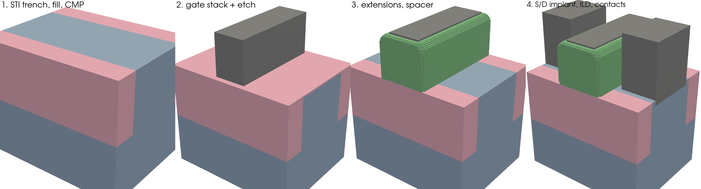

# 3D virtual fab: details

[Back to the README](../README.md)

## 3D virtual fab (`fab/`, `configs/fab_planar.yaml`)

Builds a 3D device the way a fab does, one process step at a time, and
writes a snapshot after every step so you can scrub through the build.

`python3` in these commands means the project's environment. Run them from
`tcad1d/` after `source .venv/bin/activate`, or write `.venv/bin/python`
instead. A system `python3` (e.g. Homebrew's) has no PyVista/Qt and reports
"No module named tcadview". 3D solves (`fab simulate`) run faster in the
conda env with PETSc: `~/miniconda3/envs/tcad/bin/python`.

```bash
python3 -m fab build configs/fab_planar.yaml      # ~1.5 s build + ~2.5 s snapshots
python3 -m tcadview out/fab_planar/build.pvd      # "Process step" slider, colours by material
python3 -m fab expand configs/fab_planar.yaml     # the explicit, editable flow the template generates
```

<p align="center">
  
</p>

**The planar template** (`template: planar`) is a bulk NMOS or PMOS with a
finite width and STI on both sides:
1. substrate doping
2. STI trench, fill and CMP
3. well/Vt implant
4. gate dielectric over the whole flat surface, so the gate bottom is
   level over the channel and the STI alike
5. gate metal (TiN by default; `gate_material: Poly` also works), then a
   gate etch stopping on the dielectric
6. strip of the exposed gate dielectric only, which leaves the STI flush
   with the silicon (no recess step for the spacer to leave stringers in)
7. extension implant, self-aligned to the gate
8. nitride spacer (conformal deposit plus anisotropic etch)
9. source/drain implant, self-aligned to the gate and spacer
10. ILD fill and CMP to `ild_cap` above the gate, so dielectric (never
    gas) sits between the spacer and the contacts
11. contact trenches etched through the ILD, recessed `contact_recess`
    (5 nm) into the S/D, a shallow high-dose contact implant, then filled
    with TiN (`contact_material`) up to the ILD top: whole metal volumes,
    taller than the gate (their sidewalls facing the gate are much of the
    off-state capacitance)

Every dimension is a parameter (`Lg`, `tox`, `spacer`, `W`, `sti_depth`,
the implant peaks and ranges, the voxel size, ...).

**The YAML has three layers.**
- Layer 1 is a template plus parameters.
- Layer 2 is the explicit process flow: what `fab expand` prints, editable,
  with every number an expression over the parameters (`"xg0 - spacer"`).
- Layer 3 is the device: contacts.

**How it works.**
- Each region is a level set on a uniform voxel grid.
- Each step is one geometric operation:
  - **conformal deposit:** an exact offset of the distance field, so
    corners round with the right radius
  - **fill and CMP**
  - **anisotropic etch:** a vertical sliding minimum of the gas visible
    from above, which keeps etched edges sub-voxel accurate and shadows
    overhangs
  - **isotropic etch**
  - **analytic implants:** Gaussian in depth, with a lateral erfc under
    mask and gate edges
- Distances are recomputed only when a step needs them, by a closest-point
  method that is exact on flat faces and about 0.02 nm on curved ones.
  Its inner loop is in Rust (`native/`), 7x faster than the numpy fallback.

**What is checked** (`testsuite/test_fab.py`):
- Each operation against analytic geometry: conformal corner radius,
  spacer width, etch stop, selective growth, implant depth and dose.
- The planar build against its own parameters: gate edges, oxide
  thickness, spacer width (8.000 nm for 8 nm), STI depth, the STI flush
  with the silicon, a flat gate bottom, and the junction depth against
  the Gaussians.
- **The viewer shows the device geometry exactly.** For a build, tcadview
  draws each material as the voxel faces the device is built from: sharp
  edges, and two materials share one face. The smooth level-set contours
  are a checkbox ("smooth surfaces"). They look nicer, but bevel every
  edge by up to a voxel and draw neighbouring materials as separate
  surfaces.
- **The structure check, after every build:** enclosed gas voids, detached
  fragments of a region, and layers one voxel thick are warnings in the
  build log. One-voxel flakes (the staircase of a curved surface poking
  out by a voxel) are relabelled to their surroundings and counted. A
  thin film between two different materials is never touched.
- A round trip through the layer-2 YAML.
- The snapshots in the viewer.
