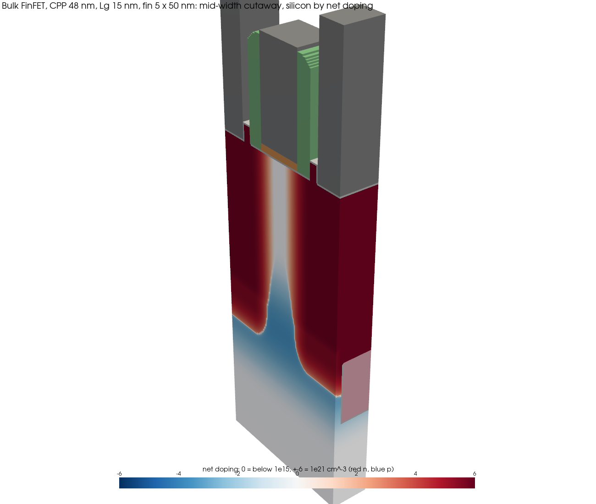
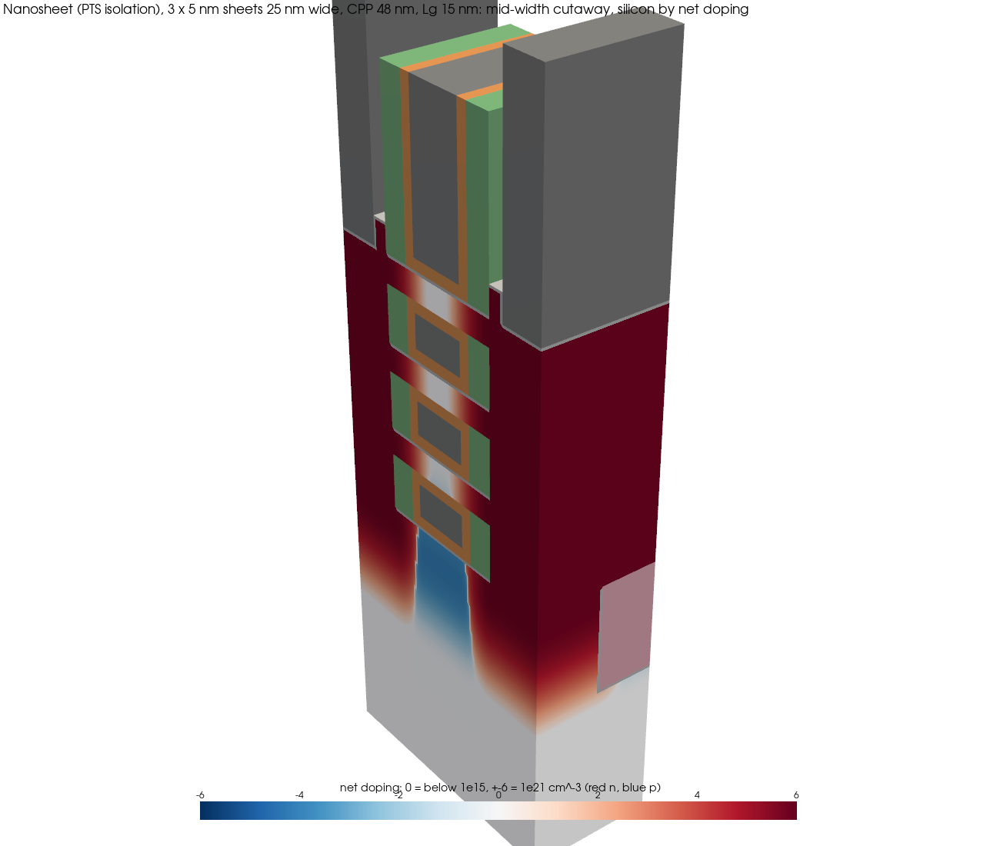
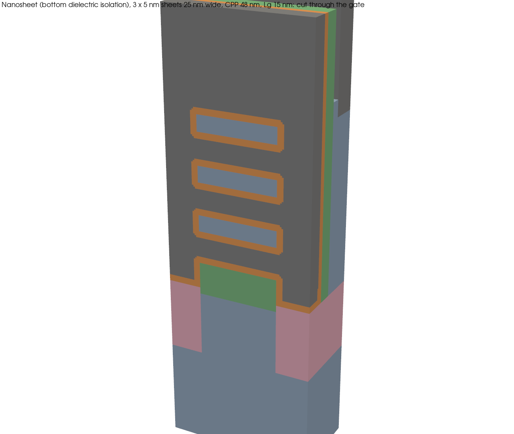
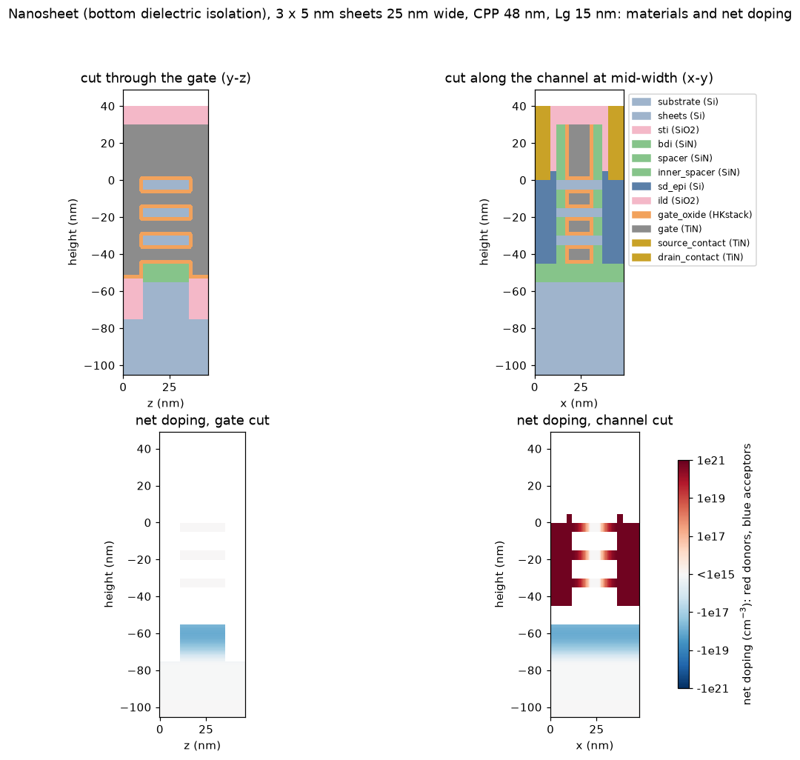
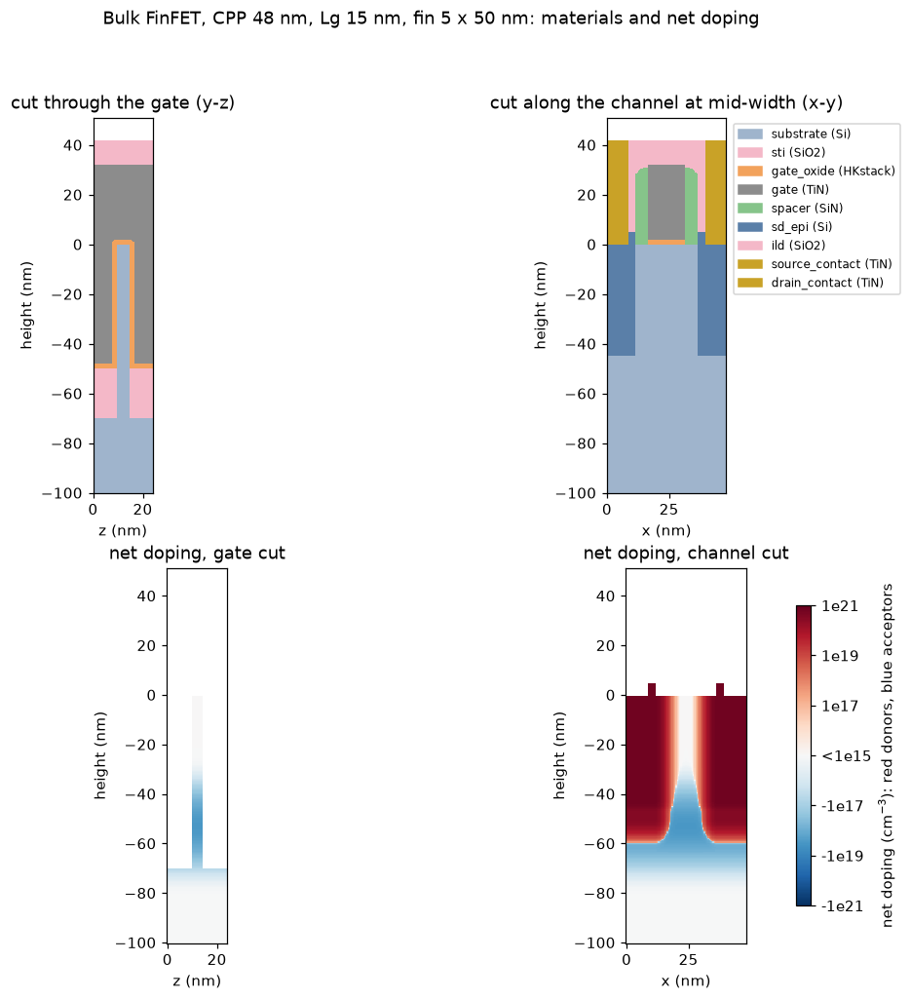
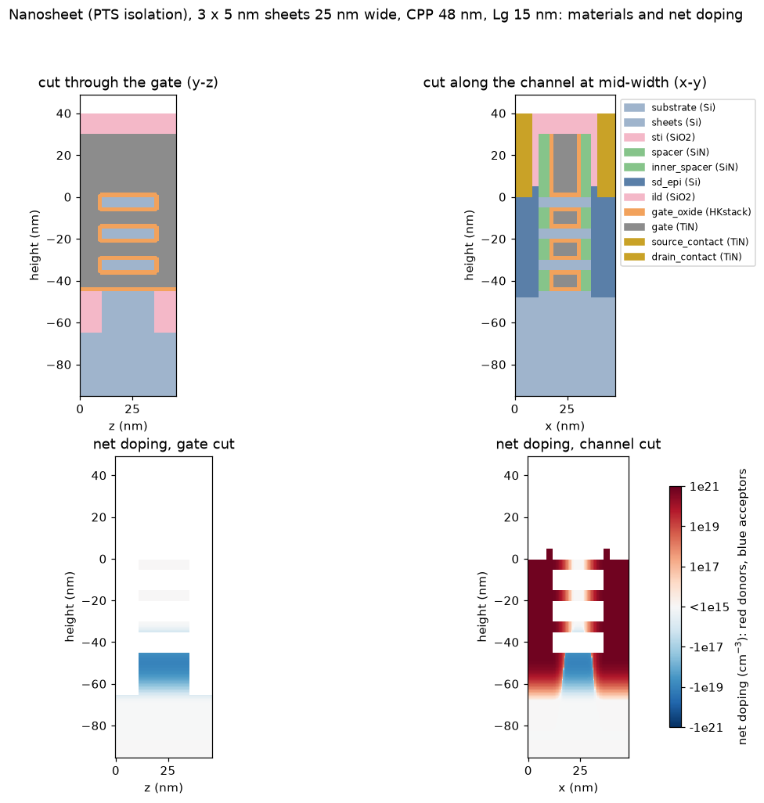

# FinFET and nanosheet flows: details

[Back to the README](../README.md)

Two new virtual-fab templates at 2 nm-node-class dimensions: a bulk FinFET
and a 3-sheet nanosheet (gate-all-around), the nanosheet with two ways of
isolating the substrate under the stack. Plan:
`plans/finfet_nanosheet_plan.md`. Numbers: DEVELOPMENT_LOG 70.

```bash
python3 -m fab build configs/fab_finfet.yaml        # ~1 s + snapshots
python3 -m fab build configs/fab_nanosheet.yaml     # ~3 s + snapshots (PTS isolation)
python3 -m fab build configs/fab_nanosheet_bdi.yaml # bottom dielectric isolation
python3 -m tcadview out/fab_finfet/build.pvd        # scrub through the build
python3 docs/make_device_figures.py                 # the pictures below
~/miniconda3/envs/tcad/bin/python -m fab simulate configs/fab_finfet.yaml --mesher octree \
    --vds 0.05 0.7 --vgs-max 0.8 --vgs-step 0.05 [--quantum]
```

## Dimensions

The user set the fin (50 nm tall, 5 nm wide), the sheets (3 x 5 nm thick,
25 nm wide), the 48 nm contacted poly pitch (CPP) and the ~15 nm gate.
The rest are typical published 3-2 nm-node values:

| | FinFET | Nanosheet |
|---|---|---|
| CPP / Lg / spacer | 48 / 15 / 5 nm | 48 / 15 / 5 nm (+ 5 nm inner spacers) |
| body | fin 5 x 50 nm, 24 nm fin pitch | 3 sheets 5 x 25 nm, 10 nm gaps, 46 nm stack pitch |
| gate stack | IL + HfO2 lumped, 2 nm, EOT 0.85 nm; TiN, wf 4.40 eV | same, wrapping every sheet |
| S/D | recessed fin, Si:P epi 7e20 (sx 2, sy 3 nm) | epi from the sheet ends, 7e20 |
| isolation | PTS 3e18 at the fin base | `pts`: PTS 1e19 under the stack (sharp, sigma 4 nm); `bdi`: 10 nm SiN under the stack + PTS 1e18 |
| contacts | TiN trench contacts, Schottky (0.45 eV) | same |

The domain is one CPP along x (the gate in the middle, half of each shared
contact at the ends) and one fin / stack pitch along z. The width walls
are symmetry planes, i.e. neighbouring fins. Currents are per um of
effective width (2 H_fin + W_fin = 105 nm per fin; 2 x 3 x (25 + 5) =
180 nm per stack).

## The flows

**FinFET** (`template: finfet`, bulk, gate-first):
1. substrate; fin etch 70 nm (50 nm fin + 20 nm in the STI)
2. STI fill and CMP; punch-through stopper implanted through the STI,
   peaked at the fin base
3. fin reveal: STI recess by 50 nm
4. gate dielectric (conformal), TiN fill, gate etch, dielectric strip
   (everything exposed, the fin side walls included)
5. SiN spacer; spacer etch that clears the fin side walls outside the
   gate + spacer footprint
6. S/D fin recess, stopping 5 nm above the STI, so the epi stays above the
   PTS (the sub-fin under the gate was the off-state leakage path)
7. selective epi from the exposed Si, capped 5 nm above the fin top, with
   its analytic in-situ doping (below)
8. ILD, CMP, TiN trench contacts recessed 5 nm into the epi

**Nanosheet** (`template: nanosheet`, replacement metal gate):
1. substrate, then the superlattice: 3 x (SiGe 10 nm, Si 5 nm); with
   `isolation: bdi` a 10 nm sacrificial (high-Ge) SiGe layer under it
2. stack etch, STI, PTS, STI recess to the stack bottom (BDI: 2 nm short
   of the mesa top, which the STI must cover - flush, the S/D epi beside
   the stack touched the mesa's top edge)
3. dummy poly gate. BDI: the sacrificial layer is removed under the whole
   stack (the dummy gate holds it), a conformal SiN closes the cavity, and
   a directional etch-back that stops on any other solid clears the film
   from every surface seen from above. Outer spacer (cleared from the
   stack side walls)
4. S/D recess through the stack (PTS: 3 nm into the mesa; BDI: down to
   the SiN)
5. SiGe lateral recess (5 nm, isotropic, SiGe only), inner-spacer SiN
   fill, and a directional etch-back to the sheet ends. An isotropic
   etch-back deep enough to clear the sheet ends also hollowed the
   pockets, because the deposit's surface dips at every gap mouth.
6. S/D epi from the sheet ends and the mesa
7. ILD + CMP to open the dummy gate; dummy-gate pull; channel release
   (all SiGe removed)
8. gate dielectric wrapping every sheet; TiN fill between the sheets;
   gate CMP; ILD cap; contacts

<p align="center">
  
  
</p>
<p align="center">
  
  
</p>
<p align="center">
  
  
</p>
<p align="center">
  
  
</p>

## New fab operations

- **`epi_doping`**: the S/D epitaxy's in-situ doping, analytic. Inside the
  epi it is the peak. Outside, it falls off as a Gaussian of the distance
  to the epi, scaled per axis:

  ```math
  N = N_{peak}\,\exp\!\Big(-\tfrac{1}{2}\big(\tfrac{d_x}{s_x}\big)^2-\tfrac{1}{2}\big(\tfrac{d_y}{s_y}\big)^2-\tfrac{1}{2}\big(\tfrac{d_z}{s_z}\big)^2\Big)
  ```

  (d_x, d_y, d_z) is the offset to the nearest epi point in the scaled
  metric (an anisotropic distance transform). For a box-shaped epi this is
  exactly the separable exp(-dx²/2sx²) exp(-dy²/2sy²). sx sets the
  junction under the spacer (the overlap), sy the tail below the epi.
  Checked against the closed form in `test_fab`. The tail reaches only
  semiconductor connected to the epi: it does not cross a dielectric (the
  BDI), however thin.
- **Capped conformal deposit** (`to_height` with `mode: conformal`): the
  selective epi grown to a height.
- **`HKstack`**: a 0.6 nm SiO2 interlayer plus 1.4 nm HfO2, lumped into one
  2 nm layer with the same EOT (0.85 nm, eps 9.2). A 0.6 nm interlayer of
  its own would need a 0.25 nm voxel.
- **Template mesh spacing** (`mesh_h_fine`): the octree's planar default
  puts 2 nm in z at z-facing interfaces, which leaves 5 nodes across a 5 nm
  fin. FinFET and nanosheet use (1, 0.5, 0.5) nm. It matters: FinFET DIBL
  went from 52 to 66 mV/V and Ioff tripled with the finer mesh.

## Electrical results

Classical drift-diffusion (octree mesh, Schottky S/D, hybrid velocity
saturation), Vds = 0.05 / 0.7 V, two workers. Currents per um of effective
width; Ion at Vgs = 0.8 V.

| device | Vt lin / sat (V) | SS (mV/dec) | DIBL (mV/V) | Ion (uA/um) | Ioff (A/um) | full I-V |
|---|---|---|---|---|---|---|
| FinFET | 0.205 / 0.162 | 62 | 66 | 1015 | 2.6e-7 | 190 s |
| nanosheet, PTS 1e19 | 0.206 / 0.101 | 72 | 163 | 1101 | 4.6e-6 | 585 s |
| nanosheet, BDI | 0.207 / 0.176 | 61 | 48 | 1046 | 2.1e-8 | 427 s |

- BDI isolates the mesa: Ioff 220x lower, DIBL 48 instead of 163 mV/V,
  SS 61 instead of 72 mV/dec. With only a punch-through stopper (even at
  1e19) the S/D epi still reaches the substrate under the stack, a
  sub-sheet leakage path the gate does not control.
- Gate steps of 0.1 V for the nanosheet, 0.05 V for the FinFET; the
  adaptive walk takes about the same continuation steps either way.
- Runtime history (BDI nanosheet, both curves): 2050 s (direct LU, one
  worker) -> 717 s (update-based convergence) -> 427 s (adaptive ILU level,
  dielectric-light mesh, ramps in the workers): DEVELOPMENT_LOG 71.

## Known issues / next

- **Near-threshold walk steps.** At Vds = 0.05 V about 45% of the
  nanosheet walk goes to failed gate steps between Vgs 0.15 and 0.34 V
  (the FinFET similarly). Cause: the S/D junction tail at the drain end
  of the channel (doping ~8e15) sits at the hybrid force's crossover
  density (1e16), where the drive switches to the edge field - there the
  junction's built-in field - and a small drop of n collapses the
  mobility. A higher crossover density cures it but moves subthreshold Id
  by -36%: not taken. The Jacobian is exact; globalization variants did
  not help (DEVELOPMENT_LOG 71).
- Corners of fins and sheets take the larger Lambda of their two lines (a
  first pass; 2D cross-section Schrodinger slices, quantum plan P4, would
  replace it).
- PMOS variants (SiGe:B 5e20 epi) work through `type: pmos` but are not
  validated yet.
