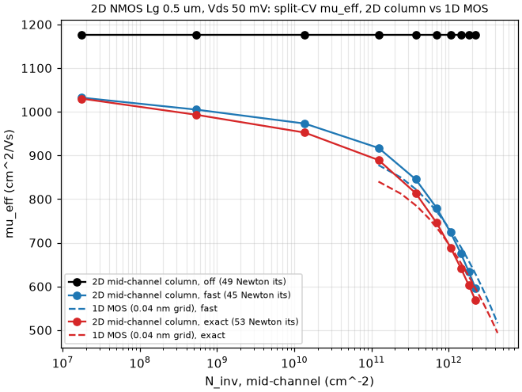

# Inversion-layer mobility: phonon, surface roughness, Coulomb, orientation

[Back to the README](../README.md)

Code: `solver2d/surface_mobility.py`, wired into `low_field_mobility`
(`solver2d/newton_solver_qf_2d.py`). DEVELOPMENT_LOG 83.

## How to enable it, and the defaults

The model is **ON by default, in fast mode** (the plan's proposal; the
user may still choose OFF as the default, see the end of this page):

- 3D fab devices: `fab simulate ... --mobility fast` (default),
  `--mobility exact`, or `--mobility off` (the previous bulk-only mobility,
  bit for bit). `--orientation auto` (default) or `100`;
  `--mobility-set key=value` for the options below.
- 2D: `physics: mobility: fast | exact | off` in a `main2d_mosfet_sweep`
  config (a mapping with `mode:` plus the option keys also works), or
  `main2d_mosfet_sweep.py --mobility fast|exact|off`, which overrides the
  config. Default fast.
- Off by default inside fast and exact: the interface charge (0), the
  remote high-k terms (`highk=0`). On by default: the surface terms, the
  orientation sets, the total-doping bulk term, the D-continuity interface
  field.

Before this, the low-field mobility was the bulk doping-dependent value
(Masetti) from the NET doping: a carrier at the gate interface moved as fast
as one in the bulk. Real inversion layers lose mobility to the gate field
(phonons, interface roughness) and to charge near the interface. That is the
"universal mobility" every TCAD tool models.

## The pipeline

Per node, Matthiessen's rule, then per edge (the mean of its two nodes), in
the Sentaurus order:

```
1/mu_low = 1/mu_bulk(N_A + N_D [, n, p])                 Masetti (fast) | Klaassen (exact)
         + D * s_orient * (1/mu_ac(F) + 1/mu_sr(F))      Lombardi (fast) | Darwish (exact)
         + D / mu_ic(F, N_it, n or p)                    interface charge (opt-in)
         + D * D_hk * (1/mu_rcs + 1/mu_rps)              remote high-k Coulomb + phonon (opt-in)
mu_edge  = mean of the two nodes  x  stress factor (piezo, docs/piezo_mobility.md)
           [ballistic term: branch ballistic-mobility]   ->  velocity saturation (docs/vsat_modes.md)
D = exp(-x / 10 nm),  x = distance to the nearest semiconductor/insulator interface
```

- **mu_ac = B/F + C·((N + N2)/N0)^λ / (F^(1/3) (T/300)^k)**: 2D acoustic
  phonons (the B term) and the doping-dependent phonon term.
- **mu_sr = (F^A*/δ + F³/η)^-1**: surface roughness, dominant at high field.
  Exact mode: A* = A + α(n + p)/(N + N1)^ν (Darwish), so roughness scattering
  grows with the inversion density.
- **Coulomb, channel doping**: through the bulk model, now from the TOTAL
  doping N_A + N_D. The fab knows both species; `mesh.Ntot` is attached by
  `fab simulate`. A 2D config mesh only has the net doping and falls back to
  it. In exact mode the bulk model is Klaassen's (Philips unified): the
  impurity scattering is screened by the free carriers, so a doped channel
  in strong inversion is not over-degraded the way Masetti does it.
- **Coulomb, interface charge**: `--mobility-set interface_charge=<cm^-2>`
  puts a fixed sheet charge on every semiconductor/insulator interface. It is
  in Poisson (it shifts Vt), it adds q·Qit/ε_Si to the interface nodes'
  normal field (the D-continuity value is the oxide side; the silicon side
  carries the sheet charge too), and it scatters carriers with Sentaurus'
  interface-charge form (Eq. 311):
  μ_C = μ1 [1 + (c / (c_trans x^ν1))^γ] / (x^ν2 · D · f(F)), x = Qit/1e11,
  f(F) = 1 - exp(-(F/E0)^ε) switching it off at flat band, c the local
  carrier density (screening). Off by default (0). The interface-trap
  roadmap will feed it the trapped charge later.
  - **Calibrated, not Table 63**: μ1 = 200, c_trans = 5e16 (Table 63:
    40, 1e18; `coulomb_mu1=40 coulomb_c_trans=1e18` restores them). With
    Table 63's values, Qit = 1e11 already halves μ_eff near threshold and
    Qit = 3e11 still costs 74% at N_inv > 2e12 (1D harness, Na 1e16,
    tox 5 nm), far beyond measured Coulomb losses and beyond the other
    terms. Calibrated target: 10-30% near threshold for Qit 1e11-5e11, under
    ~5% above N_inv 2e12, screening merging the curve into phonon + SR.
  - 2D check (configs/input_mosfet_2d.yaml, Vds 50 mV, μ_eff of the
    mid-channel column against the same run without Qit, same N_inv):

    | Qit (cm^-2) | N_inv 1e11 | 3e11 | 5e11 | 1e12 | 2e12 | 4e12 | Id-Vg |
    |---|---|---|---|---|---|---|---|
    | 1e11 | -4.3% | -2.3% | -1.3% | -0.9% | -0.5% | -0.3% | monotonic |
    | 3e11 | -12.6% | -9.8% | -8.1% | -5.5% | -3.5% | -2.3% | monotonic |
    | 1e12 | | | -32% | -26% | -20% | | monotonic |

  - Two bugs in the first version (DEVELOPMENT_LOG 83): ν1 and ν2 were
    swapped (x^-1 unscreened instead of x^-0.5, and the screening density
    scaled by x^0.5 instead of x), and the interface field ignored the sheet
    charge. At Qit 1e12 it gave μ_eff 200 -> 380 -> 50 and a falling Id
    (negative gm). A regression test checks Id-Vg monotonic and μ_C rising
    with N_inv at Qit 1e12.
- **Remote Coulomb and phonons from the high-k** (`highk=1`, off by default):
  Tanimoto's remote Coulomb and Zhu and Ma's remote phonon term, weighted by
  exp(-d_hk / 1 nm), d_hk the distance to the nearest insulator node with
  eps_r > 8. Both are empirical. The (N/3e16)^γ doping factor of the remote
  Coulomb term goes to 0 for an undoped channel, so N is floored at 1e15.
- **Not implemented**: Coulomb2D (local channel impurities as a separate
  component; it double-counts Masetti/Klaassen), the to-current normal field,
  thickness-fluctuation scattering (ThinLayer).

## The normal field F

F at a node is |∇ψ · n̂|, n̂ the normal of the nearest interface node, from one
sparse operator per mesh (one SpMV per evaluation):

- **Interface nodes**: the displacement flux through the node's insulator
  edges divided by ε_Si (D-continuity, ε_ox E_ox = ε_Si F_s). The oxide holds
  no charge, so its field is resolved on any mesh. A test checks it against
  the 1D MOS solution's charge (Gauss, exact) and the analytic surface field.
  Sentaurus uses a ξ-correction of the one-sided value instead; the plain
  one-sided value is the `interface_field=lsq` option.
- **Other nodes**: a least-squares gradient over the node's semiconductor
  neighbours (exact for a linear ψ on triangles, rectilinear and octree
  meshes; tested).
- The interface set is every semiconductor/insulator interface (the Sentaurus
  default): gate dielectric, STI, spacers. The metal-surface nodes of the
  S/D contacts are not a dielectric; the gate contact's are (they sit on the
  gate dielectric).
- F is floored at 1e3 V/cm (Sentaurus `EnormMinimum`).

## Surface orientation

Each interface node's normal is rotated into the crystal frame ((001) wafer,
<110> channel: device x = [110], y = [00-1], z = [-110]) and matched to the
<100>, <110> and <111> families. The (100) planar surface and fin and sheet
tops are (100); the FinFET sidewalls and the sheet edges are (110). A
corner node's bisector normal is nearest <111>.

- **fast**: the nearest family. **exact**: a blend w_k ~ exp(-(1 - |cos θ_k|)/0.02),
  which only acts at corners.
- **Electrons**: the (110) set is the (100) set. FinFET sidewall data
  (Kavalieros 2008, Young SSE 2012, VLSI 2011) show (110) sidewalls like (100);
  a planar (110) wafer is lower (0.6-0.8x): `scale_110_n=0.7`.
- **Holes**: (110) mu_ac and mu_sr x 3.13, calibrated in the 1D harness so
  that mu_eff(110)/mu_eff(100) = 2.0 at E_eff = 0.5 MV/cm (Irie IEDM 2004,
  Takagi TED 41, 2363).
- `--orientation 100` uses the (100) set everywhere.

## How it is solved

The mobility depends on ψ (F), and in exact mode on n and p. It is lagged:
evaluated where Newton assembles its Jacobian, held through that
iteration's line search, and a solve is converged only once the edge
mobility stopped changing (max |dμ/μ| < 1e-4 fast, 1e-6 exact, on the edges
within reach of an interface). The Jacobian keeps its pattern and the cached
assembly plan. The converged state is exactly self-consistent; a current
evaluated after the solve re-evaluates the mobility at the converged state.
With the model off the mesh carries nothing and the solver is unchanged,
bit for bit (tested).

## Fast and exact modes

| | fast (default) | exact |
|---|---|---|
| surface terms | Lombardi (Sentaurus Table 58) | Darwish/Lucent (Table 59) with A* |
| bulk | Masetti, total doping | Klaassen (Philips), carrier screening |
| orientation | nearest family | smooth blend at corners |
| self-consistency | 1e-4 | 1e-6 |

Measured fast against exact (same meshes):

| check | fast | exact |
|---|---|---|
| 1D universal curve, max deviation 0.3-1.2 MV/cm, N = 1e17 (e / h) | 12% / 21% | 4% / 26% |
| 2D long channel (Lg 0.5 um), Id / Id(off) at Vgs 1.0 / 1.5 V, Vds 50 mV | 0.740 / 0.532 | 0.718 / 0.511 |
| 2D NMOS Lg 0.5 um, Ion (Vds 1 V) | 145.7 uA/um | 141.5 uA/um |
| 2D PMOS Lg 30 nm, Ion (Vds -1 V) | 623.9 uA/um | 675.4 uA/um |
| Newton iterations, 2D long-channel sweep (off 49) | 45 | 53 |

The two modes agree to within 3-8% on Ion; exact is the higher-fidelity
choice for doped channels (Klaassen screening), fast the cheaper one.

## Universal mobility check

`scripts/mobility/universal.py`: a 1D MOS capacitor (classical, or
Schrodinger-Poisson with `--quantum`) over a gate sweep, the SAME
`SurfaceMobility` evaluated on it, μ_eff = Σμn/Σn (split-CV) against
E_eff = (Q_dep + ηQ_inv)/ε_Si (η = 1/2 electrons, 1/3 holes), and the
universal curves (Takagi; Chen/Hu fits: μ_n = 540/(1 + (E/0.9)^1.85),
μ_p = 185/(1 + E/0.563), E in MV/cm).

`python3 scripts/mobility/universal.py --out docs/img` (23 s). Maximum
|μ_eff/μ_univ - 1| over E_eff = 0.3-1.2 MV/cm, classical charge:

| set | carrier | N_A = 1e16 | 1e17 | 5e17 | 1e18 |
|---|---|---|---|---|---|
| fast (Lombardi + Masetti) | electrons | 34% | 12% | 35% | 44% |
| fast | holes | 13% | 21% | 29% | 32% |
| exact (Darwish + Klaassen) | electrons | 12% | 4% | 23% | 15% |
| exact | holes | 22% | 26% | 27% | 25% |

How to read it:
- The Chen/Hu fit is the doping-independent universal branch. At
  N >= 5e17 the measured curves (Takagi Part I) also fall below it at low
  E_eff, from channel-impurity Coulomb scattering; the largest deviations
  there are at the low-field end, where the model (Masetti on the total
  doping) is below the fit. That is expected, not a calibration error.
- Fast electrons at N = 1e16 sit above the fit at high field (+34% at
  1.2 MV/cm): the original Lombardi roughness term is weaker than the
  universal curve's. Exact (Darwish A*) fixes most of it.
- (110) holes: μ_eff(110)/μ_eff(100) = 2.0 at 0.5 MV/cm by construction
  (`--calibrate`).

## 2D split-CV check (the FV normal field end to end)

`python3 scripts/mobility/long_channel_2d.py --out out/mobility` (32 s):
the 2D NMOS of `configs/input_mosfet_2d.yaml` (Lg 0.5 um, tox 5 nm,
Na 1e16, 2.5 nm interface spacing) at Vds = 50 mV, μ_eff = Σμn/Σn over a
mid-channel column, against the 1D harness (0.04 nm grid) at the same N_inv.

| N_inv (cm^-2) | 1.1e12 | 1.4e12 | 1.8e12 | 2.2e12 |
|---|---|---|---|---|
| fast, 2D column vs 1D | -0.5% | -2.1% | -3.7% | -5.3% |
| exact, 2D column vs 1D | -0.3% | -1.8% | -3.2% | -4.5% |

The column mobility drops from 1177 (off) to 595 cm²/Vs (fast) at
N_inv 2.2e12. The coarse 2D mesh with the D-continuity interface field
reproduces the finely resolved 1D result within 5.3%; the remaining gap
grows with the field (the 2.5 nm cells average F over the inversion layer).




## Device results

DEVICE_TABLE

## Parameters and sources

| model | parameter | electrons | holes | source |
|---|---|---|---|---|
| Lombardi | B, C | 4.75e7, 580 | 9.925e6, 2947 | Sentaurus UG N-2017.09 Table 58; ATLAS Table 3-28 |
| | λ, k, δ, A, η | 0.125, 1, 5.82e14, 2, 5.82e30 | 0.0317, 1, 2.0546e14, 2, 2.0546e30 | same |
| | l_crit | 10 nm | 10 nm | same |
| Darwish | B, C, λ, k | 3.61e7, 1.70e4, 0.0233, 1.7 | 1.51e7, 4.18e3, 0.0119, 0.9 | Darwish TED 44, 1529 (1997); Table 59 |
| | δ, A, α⊥, ν | 3.58e18, 2.58, 6.85e-21, 0.0767 | 4.10e15, 2.18, 7.82e-21, 0.123 | same |
| Klaassen | μmax, μmin, θ, Nref, α | 1417, 52.2, 2.285, 9.68e16, 0.68 | 470.5, 44.9, 2.247, 2.23e17, 0.719 | Klaassen SSE 35, 953 (1992); Tables 56/57 |
| interface charge | μ1, c_trans | 200, 5e16 | same | calibrated here (Table 63: 40, 1e18) |
| | γ, ν1, ν2, E0, ε, N0 | 1.5, 1, 0.5, 2e5, 2, 1e11 | same | Sentaurus Eq. 311, Table 63 |
| remote Coulomb | μ0, γ1..γ5, s, c0 | 149, 0.232, 2.1, 0.40, 0.05, 1, 0.1, 3e16 | same | Tanimoto SISPAD 2006; Table 64 |
| remote phonon | μ0, γ1, γ2 | 496.7, 0.68, 0.34 | same | Zhu and Ma EDL 25, 89 (2004); Table 65 |
| orientation | (110) surface scale | 1.0 | 3.13 (μ_eff ratio 2.0 at 0.5 MV/cm) | calibrated here; Irie 2004; Kavalieros 2008 |

The Sentaurus numbers were read from the user guide for the plan
(`out/passdown_logs/mobility_plan.md`, sections 1-2, 6). The interface-charge
form was re-read from Eq. 311 for the fix above; the remote-Coulomb formula
is still the plan's reading of the guide.

Options (`--mobility-set k=v`, or keys of `physics: mobility:` in 2D):
`interface_charge`, `coulomb_mu1`, `coulomb_c_trans`, `highk`, `orientation`, `interface_field` (dcont | lsq),
`doping` (total | net), `l_crit`, `F_min`, `scale_110_n`, `scale_110_p`,
`surface_scale_n/p` (μ_ac and μ_sr), `delta_scale_n/p` (μ_sr only),
`smoothing`, `tol`.

## Known simplifications

- SiGe nodes (PMOS S/D, nanosheet sacrificial layers) take the Si surface
  parameters. Only Si channels invert, so this is harmless.
- The Lombardi/Darwish sets were fitted with a classical inversion charge.
  With `--quantum` the charge sits ~1 nm deeper and samples a lower field.
- The interface charge is uniform on every interface. A per-interface value
  waits for the interface-trap work.

PASSDOWN
