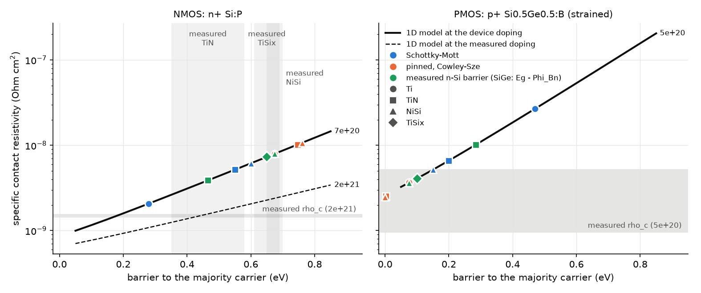

# Schottky S/D contacts: details

[Back to the README](../README.md)

## Schottky S/D contacts (`contacts/`)

In every modern transistor the source/drain contact is a metal (Ti/TiN,
often with a thin TiSix at the interface) on degenerately doped epitaxy.
That interface is a Schottky barrier, and at S/D doping almost all of the
current tunnels through it. `contacts/` models it in 1D, 2D and 3D, and
the `fab` planar template uses Schottky S/D contacts **by default**
(`contact_type: ohmic` for the ideal contact). Plan:
`plans/schottky_plan.md`; numbers and validation: DEVELOPMENT_LOG 60-62.

**The model** (the split Sentaurus and Atlas use):

1. *Thermionic emission over the barrier* (boundary condition,
   Crowell-Sze). The band at the interface sits Phi_B above the metal Fermi
   level at any bias. The flux of each carrier into the metal is
   v (n_s - n_B), with v = A** T^2 / (q N_band) (Si A** = 112 / 32 A cm^-2
   K^-2 for electrons / holes) and n_B = N_c exp(-Phi_B / kT).
2. *Tunneling through the barrier* (field and thermionic-field emission):
   for every energy below the barrier top, the WKB transmission through the
   *solved* band profile, normal to the interface, times the Tsu-Esaki
   supply function (the difference of the metal's and the semiconductor's
   Fermi occupations). The carriers enter or leave at the classical turning
   point. Nothing is a fit to a regime (TE, TFE, FE): the doping and bias
   dependence come out of the band profile.
3. *Barrier height*: given directly (`barrier_n_eV` / `barrier_p_eV`), or
   from the metal work function, either Schottky-Mott (Phi_m - chi) or
   pinned (Cowley-Sze form: S (Phi_m - chi) + (1 - S)(neutral level - chi)).
4. *Image-force lowering*: optional, off by default (at S/D doping the
   interface field is ~1e7 V/cm and the formula leaves its range).

The figure shows the two reference contacts at a small bias, in the linear
regime that sets the contact resistivity: the band diagram with every
tunneling path drawn from the metal to its turning point (the barrier
thickness at that energy; darker = more current), the current per energy
split into tunneling and over-the-barrier emission, and how both change
with the S/D doping. At S/D doping more than 99.9% of the current tunnels,
through a barrier only 0.5-0.9 nm thick near the Fermi level. Below ~1e19
the current climbs toward the barrier top (thermionic-field emission),
which is why the NMOS tunneling distance peaks near 1e19 and then drops.
(`python3 -m contacts.plot_schottky_current`)

  

**Validation** (1D, `testsuite/test_schottky.py`): the thermionic limit
equals the Richardson diode to 0.01%; the contact resistivity rho_c(N)
agrees with the independent depletion-model (Yu) calculation within
1.1-1.7x (the self-consistent barrier is slightly thicker); rho_c changes
<= 3% from a 0.05 to a 0.2 nm contact mesh; 546-point robustness matrix
(n and p, 1e17-2e21, three meshes, +/-1 V) with no failures and current
conserved to 1e-5.

### 2D and 3D: the barrier as a sub-grid boundary condition

At S/D doping the barrier is 0.5-1 nm thick, and resolving it on the device
mesh does not work: the explicit model's rho_c is off 1.8x at 1 nm spacing
and up to 15x at 2 nm. So on 2D/3D meshes the barrier is **sub-grid**
(`contacts/subgrid.py`):

- the validated 1D model (resolved on a 0.05 nm mesh) is tabulated once per
  material and contact as J(N, u), the current density vs the doping at the
  interface and the drop u from the metal to the semiconductor's quasi-Fermi
  level just past the barrier (cached on disk);
- the semiconductor nodes touching the metal become free nodes (Poisson
  keeps them neutral); their majority carrier gets J(N_i, V - phi_i)
  times the node's metal interface area, the minority carrier a thermionic
  flux - both through the solver's nodal source-term hook;
- the interface area per node comes from the exact metal/semiconductor
  voxel faces, so floors and sidewalls of any orientation count (planar,
  FinFET, nanosheet contacts alike).

Validation: a quasi-1D slab (metal | n+ 7e20, 1e20 or p+ 5e20 | ohmic) on
the fab's rectilinear mesher at 0.5, 1 and 2 nm spacing gives the resolved
1D current within 1% up to +/-0.25 V (3% at 1e8 A/cm^2), identically on all
three meshes. 3D tests: interface area, convergence, Kirchhoff, golden
currents on the tiny planar device.

**Planar NMOS (3D, octree, full Id-Vg; `python -m fab simulate`):**

| S/D contact | contacts | Ion (uA/um) | Vt lin -> sat | Newton its (Vds = 1 V) | I-V time |
|---|---|---|---|---|---|
| top contact on the S/D implant (~4e19 at the surface) | ohmic    | 1792 | 0.204 -> 0.052 | 69  | 57 s  |
| same                                                   | Schottky | 683  | 0.227 -> 0.066 | 131 | 156 s |
| **template default: 5 nm recess + contact implant (~5e20 at the metal, +34% area)** | ohmic | 1820 | 0.204 -> 0.051 | 68 | 62 s |
| **same (default)**                                      | **Schottky** | **1729 (-5.0%)** | 0.204 -> 0.051 | 69 | 72 s (87 s before the coarse correction) |

Real contacts are engineered for a low rho_c, and the template now does it
too: the contact trench is etched `contact_recess` (5 nm) into the S/D, so
the TiN also contacts the recess sidewalls, and a shallow high-dose
contact implant (`ct_peak` 7e20, Rp 2 nm) keeps the silicon degenerate
where the metal touches. Effective rho_c 7.2e-7 -> 5.8e-9 Ohm cm^2. Without
them the plain S/D implant leaves ~4e19 at the surface and the contacts
dominate the device; the ohmic contact hid this.

Cost: same Newton iterations as ohmic. A Schottky contact ties its S/D
island to the metal only through the contact conductance, far below the
island's own, so shifting the island's electron quasi-Fermi level as a
whole costs almost nothing: a near-null direction of the Jacobian that a
local ILU preconditioner cannot see (GMRES needed ~50% more iterations).
The linear solver gets those directions (one per contact island) as a
coarse space and corrects them exactly (two-level preconditioner,
`LinearSolver.set_coarse`). Drain ramp + Id-Vg walk (profiled, one
process): ohmic 32.6 s, Schottky 54.0 s before, 39.8 s now, same currents.
Full `fab simulate` I-V: 87 -> 72 s (ohmic 62 s); what remains is mostly
the serial drain ramp (36 s vs 17 s ohmic).

### Study A: one Ti/TiN metal on NMOS and PMOS (and NiSi)

Today the same contact metal sits on the NMOS S/D (Si:P 7e20) and the PMOS
S/D (strained Si0.5Ge0.5:B 5e20). How far is the plain work-function
barrier from the measured one, and how far does Fermi-level pinning move
it? And NiSi, the silicide sometimes used for PMOS contacts but rarely for
NMOS: does the model say why? (`python3 -m contacts.study_ti_barriers`)

| metal | barrier model | Phi_Bn on Si (eV) | rho_c NMOS (Ohm cm^2) | Phi_Bp on Si0.5Ge0.5 (eV) | rho_c PMOS (Ohm cm^2) |
|-------|---------------|------|--------|------|--------|
| Ti    | Schottky-Mott (Phi_m - chi) | 0.28 | 2.1e-9 | 0.47 | 2.7e-8 |
| Ti    | pinned (Cowley-Sze)         | 0.67 | 8.0e-9 | 0.08 | 3.7e-9 |
| TiN   | Schottky-Mott (Phi_m - chi) | 0.55 | 5.2e-9 | 0.20 | 6.6e-9 |
| TiN   | pinned (Cowley-Sze)         | 0.75 | 1.0e-8 | 0.00 | 2.5e-9 |
| NiSi  | Schottky-Mott (Phi_m - chi) | 0.60 | 6.2e-9 | 0.15 | 5.2e-9 |
| NiSi  | pinned (Cowley-Sze)         | 0.76 | 1.1e-8 | 0.00 | 2.5e-9 |
| TiN   | measured on n-Si, Phi_Bp = Eg - Phi_Bn | 0.47 | 3.9e-9 | 0.29 | 1.0e-8 |
| TiSix | measured on n-Si, Phi_Bp = Eg - Phi_Bn | 0.65 | 7.3e-9 | 0.10 | 4.1e-9 |
| NiSi  | measured on n-Si, Phi_Bp = Eg - Phi_Bn | 0.68 | 8.0e-9 | 0.08 | 3.6e-9 |

Work functions: Ti 4.33 eV, TiN 4.6 eV (TiN varies 4.2-4.9 with process),
NiSi 4.65 eV (near mid-gap). The "measured" rows start from the middle of
each measured n-Si barrier range and give the SiGe hole barrier as
Eg(SiGe) - Phi_Bn, i.e. the pinned level stays fixed relative to Ec.
Strained Si0.5Ge0.5 on Si: Eg 0.75 eV, chi 4.05 eV (the gap shrinks almost
entirely in the valence band, Delta Ev ~0.37 eV). Pinning: c2 = S = 0.27,
neutral level 0.30 eV above Ev (Cowley-Sze fit for Si, as quoted in Sze &
Ng; to be re-checked against the book's table).

Against the literature:

- *Measured barriers on n-Si:* TiN 0.49 eV (Wittmer & Melchior), with
  other reports from 0.35 to 0.58 eV; TiSix ~0.69 eV, ~0.61 eV under a TiN
  cap. Silicide formation moves the Ti barrier by less than 0.1 eV, and
  the Fermi level pins near mid-gap (Aboelfotoh et al.).
- *Measured contact resistivity:* 1.5e-9 Ohm cm^2 on Ti-silicided Si:P at
  2e21 (imec). In this model that needs Phi_Bn ~0.44 eV: inside the
  measured TiN range. The Schottky-Mott barrier of Ti (0.28 eV) is too
  low, the Cowley-Sze pinned values (0.67-0.75 eV) too high.
- *PMOS:* barriers on p-SiGe fall with the Ge content by about the
  valence-band offset, for every metal (the Fermi level stays pinned
  relative to Ec). Reported rho_c with TiSi on high-Ge SiGe:B: ~1-1.5e-9
  (patent) and 5e-9 Ohm cm^2 (thesis), which in this model needs
  Phi_Bp <= ~0.14 eV: the pinned model fits, Schottky-Mott does not.
  Sensitive to the hole A** and tunneling mass in strained SiGe.
- *NiSi:* measured 0.65-0.70 eV on n-Si and ~0.45 eV on p-Si. The two
  add up to Eg (the Eg - Phi_Bn transfer predicts 0.42-0.47 eV on p-Si),
  so the measured-row mapping holds on Si. Carried to Si0.5Ge0.5, the hole
  barrier falls to ~0.08 eV: NiSi gives 3.6e-9 Ohm cm^2 on PMOS (2.8x
  lower than TiN's measured barrier) but 8.0e-9 on NMOS (2x higher). That
  is the reason it shows up on PMOS contacts but rarely on NMOS. Not in
  the model: Ni(SiGe) is thermally fragile at high Ge (Ge segregates out
  of the germanosilicide above ~400 C, roughening the interface), which is
  why Ti-based contacts took over on high-Ge SiGe. NiSi is close to TiSix
  in this model (both pin near mid-gap); the real NiSi PMOS advantage is
  partly process (low-temperature formation, no TiN barrier needed).
- So neither plain model fits both: a pinning calibrated on Si, with the
  neutral level tied to Ec, gives the right NMOS/PMOS trend.

  

**Sources**

- M. O. Aboelfotoh et al., Schottky-barrier heights of Ti and TiSi2 on
  n-type and p-type Si(100), Phys. Rev. B (1986):
  <https://research.ibm.com/publications/schottky-barrier-heights-of-ti-and-tisi2-on-n-type-and-p-type-si100>
- M. Wittmer, H. Melchior, Applications of TiN thin films in silicon device
  technology (TiN/n-Si 0.49 eV), MRS Proceedings:
  <https://www.cambridge.org/core/journals/mrs-online-proceedings-library-archive/article/applications-of-tin-thin-films-in-silicon-device-technology/514348EC74B4D2E8C4C9E970D3728BF6>
- CMOS-compatible TiN for on-chip plasmonic Schottky photodetectors (TiN
  barriers on n- and p-Si): <https://arxiv.org/pdf/1905.00927>
- Metal-semiconductor junctions on p-type strained Si1-xGex layers (barrier
  vs Ge fraction):
  <https://avesis.metu.edu.tr/yayin/a7d3b2e6-b02a-466d-b8ec-166b824434bd/metal-semiconductor-junctions-on-p-type-strained-si1-xgex-layers>
- Low Schottky-barrier junctions on strained p-Si1-xGex:
  <https://avesis.metu.edu.tr/yayin/4f9cb4b6-de5b-4adc-9d2c-2bc3475d7edf/low-schottky-barrier-junctions-on-strained-p-si1-xgex-for-infrared-detection>
- H. Yu et al. (imec), record-low rho_c on Si:P epi with Ti silicidation:
  <https://scite.ai/authors/hao-yu-5QEy2>
- imec, Source/drain contact resistance: a bottleneck for advanced Si CMOS:
  <https://www.imec-int.com/en/imec-magazine/imec-magazine-april-2019/solving-the-contact-resistance-challenge-for-7nm-and-beyond-cmos>
- Patent, high-Ge high-B SiGe:B with titanium silicide (PMOS rho_c
  ~1-1.5e-9; applicant filing, not peer reviewed):
  <https://image-ppubs.uspto.gov/dirsearch-public/print/downloadPdf/12598777>
- Thesis, multi-ring CTLM on SiGe:B (5e-9 Ohm cm^2):
  <https://etd.lib.nthu.edu.tw/thesis/detail/60213f013c2765e0422c717ababd1a8a>
- N. Stavitski et al., NiSi and PtSi specific contact resistance vs doping,
  IEEE EDL (2008): <https://ris.utwente.nl/ws/files/6873332/stavitski_edl.pdf>
- NiSi barriers: ~0.65 eV for electrons and ~0.45 eV for holes on Si
  (IBM, interaction of NiSi with dopants for metallic S/D):
  <https://research.ibm.com/publications/interaction-of-nisi-with-dopants-for-metallic-sourcedrain-applications>;
  Ni2Si/NiSi 0.66 eV (IBM, barrier heights and silicide formation for Ni,
  Pd and Pt on silicon):
  <https://researchweb.draco.res.ibm.com/publications/barrier-heights-and-silicide-formation-for-ni-pd-and-pt-on-silicon>
- NiSi on p-Si, ~0.45 eV effective barrier (temperature-dependent I-V):
  <https://avesis.uludag.edu.tr/yayin/c1235786-676b-42d1-acf7-6ceafb248039/temperature-dependent-electrical-behavior-of-nickel-silicide-schottky-diodes-on-p-type-silicon>
- Ni germanosilicide on SiGe: thermal stability and Ge segregation (NCSU
  thesis; NIST presentation):
  <https://repository.lib.ncsu.edu/items/99a903b7-95a6-4de5-9886-bdd0ecb174e0/full>,
  <https://www.nist.gov/document/ozturk2005pdf>; Ni/Pt germanosilicides on
  SiGe:B near 1e-8 Ohm cm^2 (MRS):
  <https://www.cambridge.org/core/journals/mrs-online-proceedings-library-archive/article/study-on-solid-phase-reactions-of-ni-and-pt-on-sige-alloys-as-contacts-to-ultrashallow-pn-junctions-for-cmos-technology-nodes-beyond-70nm/942E5D8F6F0AE5A0B59297A27D5AD9C8>;
  Pt in NiSi moves the barrier less on SiGe than on Si (pinning, MIT):
  <https://dspace.mit.edu/handle/1721.1/7363?show=full>
- Schwarz et al., Schottky barrier lowering in Sentaurus (SB-MOSFETs):
  <https://yadda.icm.edu.pl/baztech/element/bwmeta1.element.baztech-d6289604-3281-4f73-b5dc-21dbee280809>
- Silicide/Si tunneling contacts with nanoscale barrier width:
  <https://hal.archives-ouvertes.fr/hal-00579075>
- Textbook background: S. M. Sze and K. K. Ng, Physics of Semiconductor
  Devices, 3rd ed., ch. 3 (Schottky barriers, Cowley-Sze pinning, contact
  resistivity); F. A. Padovani and R. Stratton (1966) and C. Y. Yu (1970)
  for thermionic-field and field emission.
