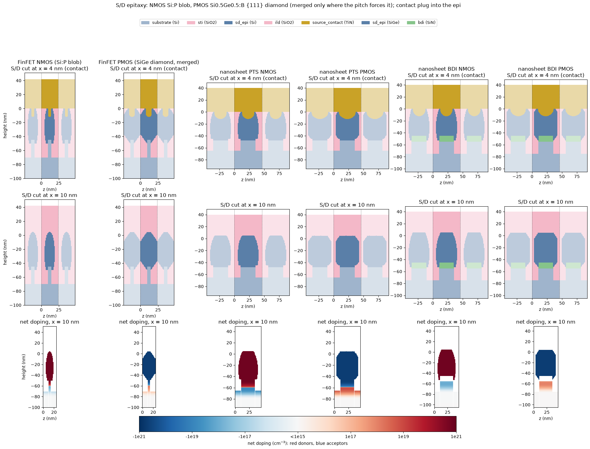

# S/D epitaxy shapes and contact plugs

[Back to the README](../README.md) · [FinFET and nanosheet flows](finfet_nanosheet.md)

The FinFET and nanosheet templates grow a shaped source/drain epi. The
NMOS Si:P epi is an elliptical blob, taller than wide. The PMOS
Si0.5Ge0.5:B epi is a {111}-faceted diamond. Neighbouring epi merges only
where the pitch forces it. Each contact is etched into its epi as a plug
with a rounded bottom, so a narrow epi still gets a large contact area.
The first flows grew a flat-topped box that filled the whole cell width
for NMOS and PMOS alike. It is still available as `epi_shape: box`.
Numbers: DEVELOPMENT_LOG 74.

```bash
python3 -m fab build configs/fab_finfet_pmos.yaml      # any FinFET / nanosheet config
python3 docs/make_device_figures.py sdcut               # the figure below
```

<p align="center">
  
</p>

Cross-sections across the width (y-z) of all six devices. The top row cuts
through the contact, the middle row cuts between the contact and the
spacer, and the bottom row shows the net doping. The faded cells left and
right are the neighbouring fins or stacks. The cell's side walls are
symmetry planes, so these are mirror images.

## Shapes

The `epitaxy` step (`fab/structure.py`) grows from every piece of silicon
left exposed in the S/D opening: the recessed fin, the fin or sheet ends
under the spacer, and the recess floor. Seeds that overlap across the
width form one group, which is a fin or a sheet stack. Each group grows
one shape. It spans the seeds in height, from its floor (the fin base, the
recess floor, or the bottom dielectric) to a flat cap `epi_over` (5 nm)
above the top. The space the S/D recess opened is always filled.

| shape | used for | cross-section |
|---|---|---|
| `ellipse` | NMOS Si:P (default) | widest `epi_lateral` beyond the fin / stack side, taller than wide, meets the floor half way out (a foot on the STI) |
| `facet` | PMOS SiGe (default) | {111} facets at 54.7 deg rising from the floor corners and falling from the cap; a vertical side `epi_lateral` beyond the seed (or a full diamond); a (100) top as wide as the fin / stack |
| `box` | the old flows | conformal `epi_thickness` growth capped at `epi_over`; identical to the first flows |

The template defaults, with the 25 nm sheets, 5 nm fin and the default
pitches:

| device | NMOS width | PMOS width | merged? |
|---|---|---|---|
| FinFET (24 nm fin pitch) | 15 nm (`epi_lateral` 5) | 29 nm (`epi_lateral` 12) | NMOS no (9 nm gap); PMOS yes: V-groove on top, ILD void below the merge |
| nanosheet (46 nm stack pitch) | 35 nm (5) | 39 nm (7) | no (11 / 7 nm gaps) |

Merging is not set anywhere. It follows from the pitch, because each shape's
mirror image across the side wall grows too. A merge or gap narrower than
two voxels is refused with an error, since it would be a sliver the mesh
cannot resolve.

The outer surface is drawn on a 1 nm lattice (`epi_lattice`). The device
mesh is built from single-material boxes, so every 0.5 nm step of a curved
surface became a 0.5 nm box. At the voxel, the epi's skin was half the
mesh the shape added. The seed envelope, the cap and the floor stay exact.
The lattice moves Id by at most 1.5% on the FinFET and the BDI nanosheet,
and by up to 4% in the PTS nanosheet's subthreshold (about 1 mV of Vt).

## Contact plugs

The contact trench removes ILD and epi together, down to a flat floor
`contact_recess` (5 nm) below the cap, which is at the fin top. On a narrow
epi, a flat floor leaves little contact: on the FinFET blob it cost 35% of
Ion. The `contact_plug` step therefore continues into the epi as a bullet:

- straight sides, `contact_plug_shell` (2 nm) inside the epi's edges;
- a round bottom, with the tip `contact_plug_depth` (12 nm) below the floor;
- a half-ellipse when the plug is wider than it is deep. The 35-39 nm
  nanosheet epi gets a round-bottomed bowl.

The plug applies to the shaped epi only. `contact_plug_depth: 0` gives the
flat floor.

## Electrical results (NMOS)

`fab simulate --mesher octree`, Vds 0.05 / 0.7 V, Vgs to 0.8 V:

| device | epi | Vt lin / sat (V) | SS | DIBL | Ion (uA/um) | Ioff (A/um) |
|---|---|---|---|---|---|---|
| FinFET | box | 0.205 / 0.162 | 62 | 66 | 1015 | 2.6e-7 |
| FinFET | blob, flat contact | 0.208 / 0.167 | 62 | 63 | 657 | 2.0e-7 |
| FinFET | blob + plug | 0.206 / 0.165 | 62 | 63 | 1042 | 2.0e-7 |
| nanosheet PTS | box | 0.207 / 0.176 | 61 | 48 | 1082 | 2.2e-8 |
| nanosheet PTS | blob + plug | 0.208 / 0.177 | 61 | 48 | 1128 | 2.2e-8 |
| nanosheet BDI | box | 0.207 / 0.176 | 61 | 48 | 1046 | 2.1e-8 |
| nanosheet BDI | blob + plug | 0.208 / 0.177 | 61 | 48 | 1076 | 2.1e-8 |

The channel hardly notices the epi shape: Vt, SS and DIBL move by 3 mV at
most. With the plug, Ion rises about 3%. The PMOS devices pass the mesh
gate and solve equilibrium, but a PMOS on-state I-V is not supported yet.

**Runtime.** The FinFET runs as fast as with the box epi (179 vs 194 s).
The nanosheet costs about 10% more measured in a single process (mesh
+16%), but the parallel `fab simulate` runs were 30-45% slower. That gap is
not understood yet and will be rechecked.

## Known limits

- The shape is extruded along the channel. Along x the epi fills the
  trench between the spacers, as in a real S/D trench, with no facets
  along x.
- The void under a merged PMOS diamond is filled with ILD (no air gap).
- The real acute corners (the ILD under a diamond's lower facet at the
  STI, the epi's curved top under the flat contact floor) leave one-voxel
  tips that the structure check reports as thin cells.
- A 2 nm `epi_lattice` fails the octree mesh gate on one device. The
  default is 1 nm.
