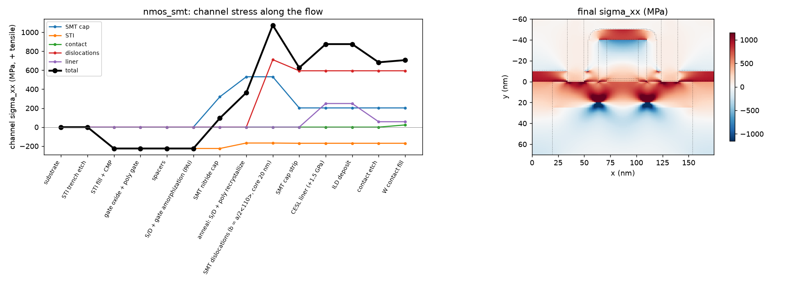
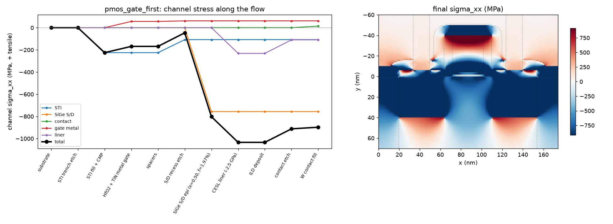
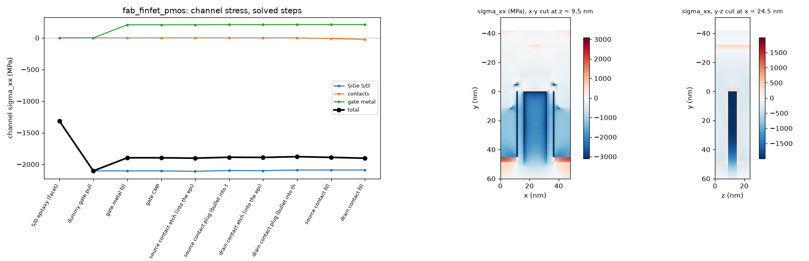
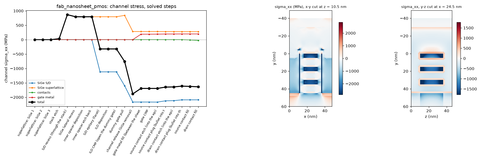

# Process stress (2D and 3D)

[Back to the README](../README.md)

A linear elastic stress solver that follows the process flow step by step,
so you can see how each stressor's input strain or stress becomes channel
stress, and in which direction. Phase 1 is 2D (plane strain, a cut along
the channel of a wide planar device). Numbers: DEVELOPMENT_LOG 76.

```bash
python3 -m mechanics.planar_flow                      # three flows, tables + figures in out/stress/
python3 -m mechanics.planar_flow --flow pmos_gate_last --set sige_x=0.3 liner_pmos_GPa=0
python3 -m unittest testsuite.test_mechanics          # closed-form and history checks
```

## What is solved

- **Elasticity.** Linear, no plasticity or viscous flow.
  - Every material has E and ν in `core/material_db.py`.
  - Si, Ge and SiGe also carry their cubic stiffness C11, C12, C44, which the solver uses instead.
  - The cubic tensor is rotated to the device frame. The default is a (001) wafer with a <110> channel: x = [110] along the channel, y = [00-1] depth (positive down), z = [-110] across the width.
  - SiGe stiffness follows Vegard's law.
- **Grid and boundaries** (`mechanics/fe2d.py`).
  - One bilinear element per 1 nm pixel.
  - The side walls are symmetry planes, so the result is a dense array of identical devices.
  - The bottom is held and the top is free.
- **Stressors.** Each takes a stress-free strain ε\* (an eigenstrain):
  - **SiGe epitaxy:** the lattice mismatch, f = (a_SiGe − a_Si)/a_Si. The SiGe lattice constant follows Dismukes, a(x) = 5.431 + 0.20x + 0.027x² Å, so x = 0.5 gives 1.97%.
  - **Films** (liner, STI oxide, gate metal, contact metal): an intrinsic stress σ0 (GPa, + tensile). It becomes the isotropic ε0 = −σ0(1−ν)/E that a flat film held by its substrate needs to carry σ0.
- **Process history.** Every step changes the structure on a fixed grid:
  - **Deposit or epitaxy:** new material joins stress-free in the current shape, and its own ε\* switches on.
  - **Etch, CMP or pull:** removed material releases the forces it exerted on the rest, and the structure re-equilibrates. This is where the dummy-gate pull and the cap strip act.
  - **Anneal:** chosen regions give up a fraction r of their stress, i.e. they recrystallize stress-free in their current shape. This is the elastic picture of stress memorization.
- **Per-stressor breakdown.** Everything is linear, so each stressor is carried as its own stress field. The total is their exact sum, from one factorization per step with one right-hand side per stressor.

## Default stressor inputs (rough literature values)

| stressor | default | in `--set` |
|---|---|---|
| SiGe S/D | x = 0.5 (f = 1.97%) | `sige_x` |
| STI oxide (HDP) | −0.3 GPa | `sti_GPa` |
| CESL nitride liner | −2.5 GPa PMOS, +1.5 GPa NMOS | `liner_pmos_GPa`, `liner_nmos_GPa` |
| TiN metal gate | −1.0 GPa | `gate_GPa` |
| W contact | +1.0 GPa | `contact_GPa` |
| SMT nitride cap | +1.5 GPa | `cap_GPa` |

Films vary widely with process; treat these as teaching values.

## Results

Lg 30 nm, spacer 8 nm, 44 nm S/D, 20 nm STI half-width, 40 nm SiGe recess.
Channel stress is the mean over the top 4 nm of the channel, in MPa (+ tensile):

| flow | σxx (channel) | σyy (vertical) | σzz (width) |
|---|---|---|---|
| PMOS SiGe, gate-first | −897 | +1180 | +371 |
| PMOS SiGe, gate-last (RMG) | −2674 | −106 | −205 |
| NMOS SMT (poly gate), cap only | +113 | −209 | −69 |
| NMOS SMT + edge dislocations | +706 | −343 | −80 |

**The poly pull.** In the gate-last flow, channel compression reaches −1455 MPa
after ILD CMP. Pulling the dummy poly takes it to −2895 MPa: the poly had
been holding the channel against the SiGe push. In the gate-first flow a
rigid TiN gate (E = 400 GPa) sits there from the start, and the SiGe gives only
−756 MPa. The vertical stress shows the same thing from the other side. Under
a gate, the SiGe squeezes the channel up against the gate (σyy ≈ +0.9 GPa).
With the gate pulled, the channel surface is free and σyy drops to about 0.

<p align="center"></p>

**Stress memorization (NMOS).** The S/D and poly are amorphized and then
capped with a +1.5 GPa nitride. The anneal lets them recrystallize
stress-free in their capped shape, and the cap is then stripped. The
channel keeps +203 MPa of tension from the cap alone, after the cap is gone.

**SMT dislocations.** During that anneal, an edge dislocation forms in each
S/D at its gate-side edge. Each one is modelled as a Volterra cut
(`mechanics/dislocation.py`):
- b = a/2<110> = 0.384 nm, along the channel;
- a half plane is missing between the core (20 nm deep) and the surface.

The two dislocations add +594 MPa of channel tension, the largest single
term, for a +706 MPa total. This is the big NMOS boost of SMT. The same
tension in a PMOS would cancel its compressive gain. Turn them off with
`--set smt_disl=0`, or move the core with `--set disl_depth=...`.

The Volterra field is checked against the analytic edge dislocation (Hirth &
Lothe), with σyy and σxy within 20% at 10-20 nm from the core. σxx is offset
by the held side walls, about E·b/L.

<p align="center"></p>

<p align="center"></p>

## Mobility preview (linear piezoresistance)

Each flow's report ends with a first-order mobility change from the final
channel stress (`mechanics/piezo.py`):

```
dmu/mu = -(pi_l sxx + pi_v syy + pi_t szz)
```

It uses Smith's (1954) π11/π12/π44, rotated to <110>/(001):
- NMOS: π_l = −31.2, π_t = −17.6, π_v = +53.4 (×1e-11/Pa);
- PMOS: π_l = +71.8, π_t = −66.3, π_v = −1.1.

| flow | dmu/mu (total) | largest term |
|---|---|---|
| PMOS SiGe, gate-first | +90% | SiGe +74% |
| PMOS SiGe, gate-last | +178% | SiGe +150% |
| NMOS SMT + dislocations | +39% | dislocations +25% |

These are linear, small-stress numbers. Measured gains saturate at GPa
stress (subband repopulation completes), so read them as trends and signs.
Phase 4 will put the full tensor into the device solver.

## Checks (`testsuite/test_mechanics.py`)

- Rotated Si stiffness: C11' = (C11+C12)/2 + C44 along <110>, C13' and C55'; isotropic materials are unchanged by rotation.
- A uniform isotropic film with eigenstrain e on a substrate gives σxx = σzz = −Ee/(1−ν), with the substrate at 0 (to 1e-6).
- SiGe on Si(001) gives σ = −(C11 + C12 − 2C12²/C11)·f along both <110> and <100> (to 1e-6).
- Mesh convergence of the stress under a film edge as the pixel goes 2 → 1 → 0.5 nm.
- Depositing a stressed film and stripping it returns the substrate to zero.
- Two stressors switched on together equal the sum of each alone.
- The memorization sequence (cap, anneal, strip) leaves a stress of the opposite sign to the one under the cap.

## 3D: FinFET and nanosheet through their real fab flows

```bash
python3 -m mechanics.fab_stress configs/fab_finfet_pmos.yaml configs/fab_nanosheet_pmos.yaml
python3 -m mechanics.fab_stress configs/fab_nanosheet_pmos.yaml --fast      # same final stress, fewer solves
```

`mechanics/fab_stress.py` snapshots every step of the fab flow
(`fab.flow.build`). It coarsens each snapshot to 1 nm and runs the 3D
history solver `mechanics/fe3d.py` on those voxels:
- one hex element per voxel, with the same birth, death and anneal rules and the same per-stressor split as 2D;
- side walls are symmetry planes, i.e. an infinite array of identical devices.

Void voxels are not in the system at all. The solve is conjugate gradients
with PETSc's algebraic multigrid (rigid-body modes from the node
coordinates), which converges in 13-15 iterations whatever the size.

**Speed.** A solve takes 2.4 s at 0.19M unknowns and 9.6 s for a row of
four devices at 0.74M, so cost is linear in size. A step costs nothing
unless it changes the stress:
- a stressor is born, or stressed material is removed;
- masks, doping and unstressed depositions are free.

`--fast` solves only when the physics forces it: before material is born
into a structure with unsolved forces, and at the end. It gives the same
final stress, because elastic removals commute until the next birth:

| | teaching (every stress-changing step) | `--fast` |
|---|---|---|
| FinFET PMOS (0.56M unknowns, 34 steps) | 12 solves, 99 s | 6 solves, 49 s |
| nanosheet PMOS (1.0M unknowns, 45 steps) | 24 solves, 335 s | 14 solves, 179 s |

**Stressors**, from the fab's region names (`--set` overrides):

| region | input |
|---|---|
| S/D SiGe epi | mismatch at x = 0.5 (1.97%) |
| nanosheet SiGe superlattice | mismatch at x = 0.30; born strained, removed at channel release |
| TiN gate | −1.0 GPa |
| TiN contacts | −1.0 GPa |
| STI, spacers | optional (`sti_GPa`, `spacer_GPa`) |

**Channel.** The silicon within 1.5 nm of the final gate dielectric, under
the gate, reported per sheet for the nanosheet.

### FinFET PMOS (gate-last), channel σxx

| step | σxx (MPa) |
|---|---|
| SiGe S/D epi, poly dummy gate holding the fin | −1313 |
| **dummy poly pull** (nothing holds the fin) | **−2104** |
| HK + TiN fill | −1896 (the TiN takes back about 200) |
| final (contacts) | −1903 |

The gate-first flow (`gate_process: first`), where the TiN gate is there
from the start, ends at −819 MPa: gate-last more than doubles the channel
compression. By stressor at the end:

| stressor | σxx (MPa) | dμ/μ (linear piezo) |
|---|---|---|
| SiGe S/D | −2090 | +150% |
| gate metal | +211 | −31% |
| contacts | −24 | +2% |
| total | −1903 | +121% |

<p align="center"></p>

### Nanosheet PMOS: the superlattice and the channel release

| step | σxx | σyy | σzz |
|---|---|---|---|
| superlattice grown (Si sheets on the Si lattice) | 0 | 0 | 0 |
| stack etch: the SiGe relaxes sideways | +34 | −48 | **+821** |
| S/D recess: the stack is cut | +867 | +22 | +815 |
| SiGe S/D epi | −322 | +899 | +935 |
| dummy gate pull | −756 | +618 | +733 |
| **channel release** (the SiGe layers removed) | **−1883** | −3 | +79 |
| TiN fill | −1693 | −47 | +2 |
| final | −1637 | −65 | −11 |

Per sheet at the end: σxx −1726, −1733 and −1743 MPa, from top to bottom
(linear piezo +115 to +124%). The channel release is the largest single
step. The compressed SiGe layers were holding the sheets in tension. Once
they are gone, the S/D epi pushes on free-standing sheets.

<p align="center"></p>

## Known limits and next phases

- 3D runs on a uniform 1 nm voxel grid. An interface-refined octree, as for the device mesh, would cut unknowns for big layouts. 1 nm vs 0.5 nm convergence is not checked yet.
- The superlattice Ge fraction (0.30) and the film stresses are rough defaults.
- The 2D planar flows are drawn by `mechanics/planar_flow.py`. The planar fab template is still gate-first, with no SiGe S/D.
- Dislocations are pure edge, with the line along the width, and the cut is
  vertical. Inclined {111} cuts work in the code (any `cut_dir`) but are not
  in the flow yet. The core position is a user input; there is no
  nucleation model.
- Piezoresistive mobility (phase 4) and the per-edge Δμ/μ = −Π:σ will use these stress fields.
- The magnitudes are high: a dense array, 50% Ge, plane strain, and liner and film values that are rough. The trends and their sign by direction are the teaching point.
