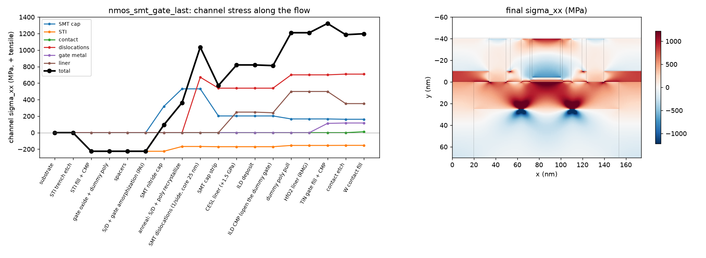
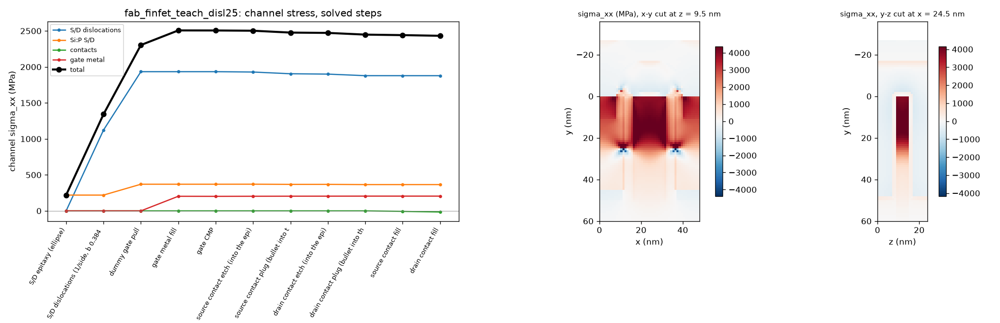
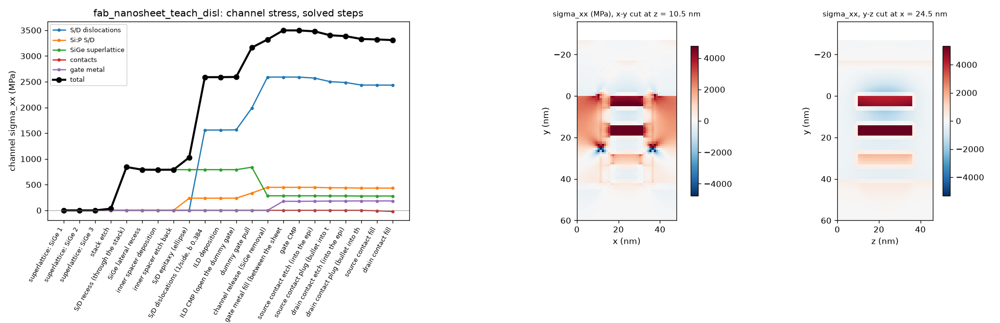

# Process stress (2D and 3D)

[Back to the README](../README.md)

A linear elastic stress solver that follows the process flow step by step,
so you can see how each stressor's input strain or stress becomes channel
stress, and in which direction. Phase 1 is 2D (plane strain, a cut along
the channel of a wide planar device). Numbers: DEVELOPMENT_LOG 76.

```bash
python3 -m mechanics.planar_flow                      # three flows, tables + figures in out/stress/
python3 -m mechanics.planar_flow --flow pmos_gate_last --set sige_x=0.3 liner_pmos_GPa=0
python3 -m unittest testsuite.test_mechanics          # closed-form and history checks
```

## What is solved

- **Elasticity.** Linear, no plasticity or viscous flow.
  - Every material has E and ν in `core/material_db.py`.
  - Si, Ge and SiGe also carry their cubic stiffness C11, C12, C44, which the solver uses instead.
  - The cubic tensor is rotated to the device frame. The default is a (001) wafer with a <110> channel: x = [110] along the channel, y = [00-1] depth (positive down), z = [-110] across the width.
  - SiGe stiffness follows Vegard's law.
- **Grid and boundaries** (`mechanics/fe2d.py`).
  - One bilinear element per 1 nm pixel.
  - The side walls are symmetry planes, so the result is a dense array of identical devices.
  - The bottom is held and the top is free.
- **Stressors.** Each takes a stress-free strain ε\* (an eigenstrain):
  - **SiGe epitaxy:** the lattice mismatch, f = (a_SiGe − a_Si)/a_Si. The SiGe lattice constant follows Dismukes, a(x) = 5.431 + 0.20x + 0.027x² Å, so x = 0.5 gives 1.97%.
  - **Films** (liner, STI oxide, gate metal, contact metal): an intrinsic stress σ0 (GPa, + tensile). It becomes the isotropic ε0 = −σ0(1−ν)/E that a flat film held by its substrate needs to carry σ0.
- **Process history.** Every step changes the structure on a fixed grid:
  - **Deposit or epitaxy:** new material joins stress-free in the current shape, and its own ε\* switches on.
  - **Etch, CMP or pull:** removed material releases the forces it exerted on the rest, and the structure re-equilibrates. This is where the dummy-gate pull and the cap strip act.
  - **Anneal:** chosen regions give up a fraction r of their stress, i.e. they recrystallize stress-free in their current shape. This is the elastic picture of stress memorization.
- **Per-stressor breakdown.** Everything is linear, so each stressor is carried as its own stress field. The total is their exact sum, from one factorization per step with one right-hand side per stressor.

## Default stressor inputs (rough literature values)

| stressor | default | in `--set` |
|---|---|---|
| SiGe S/D | x = 0.5 (f = 1.97%) | `sige_x` |
| STI oxide (HDP) | −0.3 GPa | `sti_GPa` |
| CESL nitride liner | −2.5 GPa PMOS, +1.5 GPa NMOS | `liner_pmos_GPa`, `liner_nmos_GPa` |
| TiN metal gate | −1.0 GPa | `gate_GPa` |
| W contact | +1.0 GPa | `contact_GPa` |
| SMT nitride cap | +1.5 GPa | `cap_GPa` |

Films vary widely with process; treat these as teaching values.

## Results

Lg 30 nm, spacer 8 nm, 44 nm S/D, 20 nm STI half-width, 40 nm SiGe recess.
The PMOS S/D is the bilayer epi (5 nm x = 0.2 seed + x = 0.5 fill, DEVELOPMENT_LOG 78).
Channel stress is the mean over the top 4 nm of the channel, in MPa (+ tensile;
rerun on main after the nmos-stress and piezo-mobility merges,
`python3 -m mechanics.planar_flow`):

| flow | σxx (channel) | σyy (vertical) | σzz (width) |
|---|---|---|---|
| PMOS SiGe, gate-first | −879 | +1023 | +315 |
| PMOS SiGe, gate-last (RMG) | −2524 | −136 | −206 |
| NMOS SMT (poly gate), no dislocations | +113 | −209 | −69 |
| NMOS SMT + edge dislocations (poly gate) | +652 | −293 | −65 |
| NMOS SMT + edge dislocations, gate-last (RMG) | +1198 | −27 | +65 |

The NMOS rows are broken down step by step and by stressor, with the
literature they are checked against, in [NMOS stressors](#nmos-stressors-literature-2d-planar-and-3d) below.

**The poly pull.** In the gate-last flow, channel compression reaches −1420 MPa
after ILD CMP. Pulling the dummy poly takes it to −2748 MPa (−2524 MPa at the end
of the flow, after the TiN fill and the contacts): the poly had
been holding the channel against the SiGe push. In the gate-first flow a
rigid TiN gate (E = 400 GPa) sits there from the start, and the SiGe epi gives only
−738 MPa. The vertical stress shows the same thing from the other side. Under
a gate, the SiGe squeezes the channel up against the gate (σyy ≈ +0.7 GPa after
the epi, +1.0 GPa at the end).
With the gate pulled, the channel surface is free and σyy drops to about 0.

<p align="center"></p>

**Stress memorization (NMOS).** The S/D and poly are amorphized and then
capped with a +1.5 GPa nitride. The anneal lets them recrystallize
stress-free in their capped shape, and the cap is then stripped. The
channel keeps +203 MPa of tension from the cap alone, after the cap is gone.

**SMT dislocations.** During that anneal, an edge dislocation forms in each
S/D at its gate-side edge. Each one is modelled as a Volterra cut
(`mechanics/dislocation.py`):
- b = a/2<110> = 0.384 nm, along the channel;
- a half plane is missing between the core and the surface;
- the core is at the amorphization depth (25 nm), the pinch-off point where the vertical and lateral regrowth fronts meet at the mask edge.

The two dislocations add +539 MPa of channel tension, the largest single
term, for a +652 MPa total. This is the big NMOS boost of SMT. The same
tension in a PMOS would cancel its compressive gain. Turn them off with
`--set smt_disl=0`, or move the core with `--set disl_depth=...`. (Before
DEVELOPMENT_LOG 81 the core was at 20 nm: +594, total +706.)

The Volterra field is checked against the analytic edge dislocation (Hirth &
Lothe), with σyy and σxy within 20% at 10-20 nm from the core. σxx is offset
by the held side walls, about E·b/L.

<p align="center"></p>

<p align="center"></p>

## Mobility preview (linear piezoresistance)

Each flow's report ends with a first-order mobility change from the final
channel stress (`mechanics/piezo.py`):

```
dmu/mu = -(pi_l sxx + pi_v syy + pi_t szz)
```

It uses Smith's (1954) π11/π12/π44, rotated to <110>/(001):
- NMOS: π_l = −31.2, π_t = −17.6, π_v = +53.4 (×1e-11/Pa);
- PMOS: π_l = +71.8, π_t = −66.3, π_v = −1.1.

| flow | dmu/mu (total) | largest term |
|---|---|---|
| PMOS SiGe, gate-first | +90% | SiGe +74% |
| PMOS SiGe, gate-last | +178% | SiGe +150% |
| NMOS SMT + dislocations | +35% | dislocations +21% |
| NMOS SMT + dislocations, gate-last | +40% | dislocations +24% |

These are linear, small-stress numbers. Measured gains saturate at GPa
stress (subband repopulation completes), so read them as trends and signs.
Phase 4 will put the full tensor into the device solver.

## Checks (`testsuite/test_mechanics.py`)

- Rotated Si stiffness: C11' = (C11+C12)/2 + C44 along <110>, C13' and C55'; isotropic materials are unchanged by rotation.
- A uniform isotropic film with eigenstrain e on a substrate gives σxx = σzz = −Ee/(1−ν), with the substrate at 0 (to 1e-6).
- SiGe on Si(001) gives σ = −(C11 + C12 − 2C12²/C11)·f along both <110> and <100> (to 1e-6).
- Mesh convergence of the stress under a film edge as the pixel goes 2 → 1 → 0.5 nm.
- Depositing a stressed film and stripping it returns the substrate to zero.
- Two stressors switched on together equal the sum of each alone.
- The memorization sequence (cap, anneal, strip) leaves a stress of the opposite sign to the one under the cap.

## 3D: FinFET and nanosheet through their real fab flows

```bash
python3 -m mechanics.fab_stress configs/fab_finfet_pmos.yaml configs/fab_nanosheet_pmos.yaml
python3 -m mechanics.fab_stress configs/fab_nanosheet_pmos.yaml --fast      # same final stress, fewer solves
```

`mechanics/fab_stress.py` snapshots every step of the fab flow
(`fab.flow.build`). It coarsens each snapshot to 1 nm and runs the 3D
history solver `mechanics/fe3d.py` on those voxels:
- one hex element per voxel, with the same birth, death and anneal rules and the same per-stressor split as 2D;
- side walls are symmetry planes, i.e. an infinite array of identical devices.

Void voxels are not in the system at all. The solve is conjugate gradients
with PETSc's algebraic multigrid (rigid-body modes from the node
coordinates), which converges in 13-15 iterations whatever the size.

**Speed.** A solve takes 2.4 s at 0.19M unknowns and 9.6 s for a row of
four devices at 0.74M, so cost is linear in size. A step costs nothing
unless it changes the stress:
- a stressor is born, or stressed material is removed;
- masks, doping and unstressed depositions are free.

`--fast` solves only when the physics forces it: before material is born
into a structure with unsolved forces, and at the end. It gives the same
final stress, because elastic removals commute until the next birth:

| | teaching (every stress-changing step) | `--fast` |
|---|---|---|
| FinFET PMOS (0.56M unknowns, 34 steps) | 12 solves, 99 s | 6 solves, 49 s |
| nanosheet PMOS (1.0M unknowns, 45 steps) | 24 solves, 335 s | 14 solves, 179 s |

**Stressors**, from the fab's region names (`--set` overrides):

| region | input |
|---|---|
| S/D SiGe epi | mismatch at x = 0.5 (1.97%) |
| nanosheet SiGe superlattice | mismatch at x = 0.30; born strained (pseudomorphic), removed at channel release; `sige_sl_strain=0` grows it stress-free |
| TiN gate | −1.0 GPa |
| TiN contacts | −1.0 GPa |
| NMOS Si:P S/D epi | −0.4% lattice strain (`sip_strain_pct`; see [NMOS stressors](#nmos-stressors-literature-2d-planar-and-3d)) |
| S/D edge dislocations | opt-in, `sd_disl=1` (same section) |
| STI, spacers | optional (`sti_GPa`, `spacer_GPa`) |

**Channel.** The silicon within 1.5 nm of the final gate dielectric, under
the gate, reported per sheet for the nanosheet.

### FinFET PMOS (gate-last), channel σxx

| step | σxx (MPa) |
|---|---|
| SiGe S/D epi, poly dummy gate holding the fin | −1313 |
| **dummy poly pull** (nothing holds the fin) | **−2104** |
| HK + TiN fill | −1896 (the TiN takes back about 200) |
| final (contacts) | −1903 |

The gate-first flow (`gate_process: first`), where the TiN gate is there
from the start, ends at −819 MPa: gate-last more than doubles the channel
compression. By stressor at the end:

| stressor | σxx (MPa) | dμ/μ (linear piezo) |
|---|---|---|
| SiGe S/D | −2090 | +150% |
| gate metal | +211 | −31% |
| contacts | −24 | +2% |
| total | −1903 | +121% |

<p align="center"></p>

### Nanosheet PMOS: the superlattice and the channel release

| step | σxx | σyy | σzz |
|---|---|---|---|
| superlattice grown (Si sheets on the Si lattice) | 0 | 0 | 0 |
| stack etch: the SiGe relaxes sideways | +34 | −48 | **+821** |
| S/D recess: the stack is cut | +867 | +22 | +815 |
| SiGe S/D epi | −322 | +899 | +935 |
| dummy gate pull | −756 | +618 | +733 |
| **channel release** (the SiGe layers removed) | **−1883** | −3 | +79 |
| TiN fill | −1693 | −47 | +2 |
| final | −1637 | −65 | −11 |

Per sheet at the end: σxx −1726, −1733 and −1743 MPa, from top to bottom
(linear piezo +115 to +124%). The channel release is the largest single
step. The compressed SiGe layers were holding the sheets in tension. Once
they are gone, the S/D epi pushes on free-standing sheets.

**What the superlattice strain does.** The sacrificial SiGe grows
pseudomorphic on the Si lattice, so it is born compressed. With
`--set sige_sl_strain=0` it grows stress-free instead (a what-if). The
same flow then gives:

| step | σxx, strained SL (default) | σxx, stress-free SL |
|---|---|---|
| S/D recess | +867 | 0 |
| SiGe S/D epi | −322 | −1118 |
| dummy gate pull | −756 | −1599 |
| channel release | −1883 | −2166 |
| final (channel) | −1637 | −1915 |
| final, sheets top / mid / bottom | −1726 / −1733 / −1743 | −1891 / −2094 / −2104 |

So the strained superlattice costs the final channel about 280 MPa
(+278 MPa in the per-stressor split). Before the release it holds the
sheets in tension:
- the stack etch lets the compressed SiGe expand sideways, which stretches the Si sheets;
- cutting the stack at the S/D recess turns that into +867 MPa along the channel.

Most of it leaves with the SiGe at the channel release. The part that
stays is the stretch the sheet ends kept under the spacers and inner
spacers.

**FinFET vs nanosheet.** Both have the same 48 nm CPP, 15 nm Lg and
5 nm spacer, so the S/D opening along the channel is identical. The SiGe
S/D gives almost exactly the same channel stress in both: −2090 MPa
(FinFET) and −2088 (nanosheet). The difference in the totals is the
superlattice term above, which the FinFET does not have.

<p align="center"></p>

### Bilayer PMOS S/D epi and the new dimensions

The tables above are the single-layer Si0.5Ge0.5 epi with the old gate
(30 nm) and SiGe gaps (10 nm). PMOS now grows a low-Ge seed first
(fab step `epi_seed`: `epi_seed_thickness` 5 nm of Si0.8Ge0.2, measured
inside the epi from the silicon it grew on), then the 50% fill. The seed
lines the channel-end sidewalls and the recess floor. The gate metal is
15 nm above the dielectric and the nanosheet gaps are 9 nm (DEVELOPMENT_LOG 78).
Channel σxx, `--fast`:

| seed | FinFET | nanosheet |
|---|---|---|
| 0 nm | −1908 MPa (45 s) | −1616 MPa (162 s) |
| 5 nm (default) | −1500 MPa (49 s) | −1040 MPa (172 s) |
| 7 nm | −1238 MPa (49 s) | −880 MPa (173 s) |
| 10 nm | −825 MPa (83 s) | −513 MPa (242 s) |

The new dimensions alone barely move the stress (no seed: −1908 / −1616 vs
−1903 / −1637). At 5 nm the seed is ~34% of the FinFET epi and ~44% of the
nanosheet epi, so the nanosheet loses more. With `profile: realistic`
(tapered fin, slanted round-cornered recess, seed 5 nm): FinFET −1403 MPa
(69 s), nanosheet −945 MPa (172 s), bottom sheet −799 MPa.

```bash
python3 -m mechanics.fab_stress configs/fab_finfet_pmos.yaml --fast --fab epi_seed_thickness=0 --tag seed0
```

## NMOS stressors: literature, 2D planar and 3D

NMOS wants tension along the channel (<110>). The stressors used in
production, and what the literature measured or simulated:

| stressor | what is reported | source |
|---|---|---|
| tensile CESL nitride (90-45 nm planar) | films ≥ +1 GPa (UV-cured up to ~1.4-1.7 GPa), 20-50 nm thick; a 100 nm +1 GPa cap gave +10% NMOS drive (Intel 90 nm, Ghani IEDM 2003); a PECVD film gives ~400-600 MPa of initial channel tension | [US8859357](https://image-ppubs.uspto.gov/dirsearch-public/print/downloadPdf/8859357), [US7214629](https://patents.google.com/patent/US7214629) |
| SMT, cap only (poly gate) | a few hundred MPa; most of the classic SMT gain was later traced to dislocations | (see the next rows) |
| SMT with edge dislocations (planar, gate-last) | Samsung: dislocations at the gate edge after a deep PAI + SPER under a tensile liner, ~1% lattice distortion (nano-beam diffraction), electron mobility +40-60%, Idsat > +10% (Lim, IEDM 2010) | [Semiconductor Digest](https://www.semiconductor-digest.com/intel-clarifies-32nm-nmos-stress-mechanism-at-iedm-2011/) |
| | Intel: simulated edge-dislocation stress grows as the gate pitch shrinks, reaching over 1 GPa (Weber, IEDM 2011, 34.4); stacking faults on both sides of the gate in Intel 32 nm NMOS | same |
| | IBM, dark-field holography: strain up to 1.1% (1.9 GPa) at the Si surface along <110>, generated by the SMT dislocations; +0.2% more after the poly is removed (RMG) | [IBM Research](https://research.ibm.com/publications/strain-mapping-of-si-devices-with-stress-memorization-processing) |
| | Intel patent: two vacancy edge dislocations (missing half planes) next to the channel, ~640 MPa; drops to ~400 MPa if the S/D surface is at the channel level; Idsat +16% (sim) / +20% (measured) | [US8779477](https://patents.google.com/patent/US8779477B2/en) |
| | Liao et al.: analytic model; shallower dislocations give more tension at the channel edge, with an optimal lateral offset for each depth (IEEE EDL 34(8), 2013) | [IEEE 6547670](https://ieeexplore.ieee.org/document/6547670/), [JJAP 52 04CC20](https://scholars.lib.ntu.edu.tw/handle/123456789/404488) |
| | where they form: stacking faults where the vertical and the lateral regrowth fronts meet (IBM patent); in fins, a pinch-off point after a Ge PAI (25-30 keV) and anneal, dislocations on {111} planes at ~55° to the surface (TSMC D-SMT patent) | [US8343825](https://patents.google.com/patent/US8343825), [US9570587](https://patents.google.com/patent/US9570587), [NMDC 2018](https://scholarworks.unist.ac.kr/handle/201301/80787) |
| Si:C S/D | 1.65 at.% substitutional C (SPE) gave 615 MPa of uniaxial channel tension, +35% mobility (VLSI 2007, 4A-2); n-FinFETs with 1.7% / 2.1% C gained 15% / 22% | [VLSI 2007](https://archive.vlsisymposium.org/07web/technology/tec_abstract/4A-2.htm), [Si:C FinFETs](https://www.researchgate.net/publication/3076117_Strained_n-Channel_FinFETs_Featuring_In_Situ_Doped_Silicon-Carbon_hboxSi_1_-_yhboxC_y_Source_and_Drain_Stressors_With_High_Carbon_Content) |
| Si:P S/D (FinFET, GAA) | 1.75e21 cm⁻³ P (~3 at.%, only ~1.3e20 active) is tensile, equal to ~0.8 at.% C_sub (Vegard with pseudocubic Si3P4; AMAT, ECS 2014); 2.8e21 equals ~1.8 at.% C_sub | [ECS 2014](https://ecs.confex.com/ecs/226/webprogram/Paper40706.html), [Ye et al.](https://www.researchgate.net/publication/275420423_High_Tensile_Strained_In-Situ_Phosphorus_Doped_Silicon_Epitaxial_Film_for_nMOS_Applications) |
| GAA nanosheets | the SiGe superlattice relaxing at the S/D recess puts the Si sheets in tension; the release relaxes it; the gate wrap restores some (CEA-LETI/IBM, TEM + FEM); nFET sheet-to-sheet differences of 400-800 MPa (Lam) | [ECS 2018](https://ecs.confex.com/ecs/233/webprogram/Paper110836.html), [Semiengineering](https://semiengineering.com/virtual-fabrication-meets-stress-physics-solving-gaa-channel-non-uniformity/) |

C_sub converts to a lattice strain by Vegard's law between Si and diamond,
−0.343% per at.% C. (Measured Si1−yCy deviates from Vegard by up to ~30%,
[Berti et al.](https://www.cambridge.org/core/journals/mrs-online-proceedings-library-archive/article/abs/strong-deviation-of-the-lattice-parameter-in-si1xy-gex-cy-epilayers-from-vegards-rule/7CF26706D3C4A2344B799B79A760BD24).)
So Si:P at 1.75-2.8e21 is about −0.27% to −0.62%. The default,
`sip_strain_pct = -0.4`, sits in between (~2e21 total P). Si:C with
1.65% C is −0.57%.

**Is ~1 GPa right for a planar NMOS?** Yes, but only with dislocations.
The cap and the liner alone give a few hundred MPa. Dislocations give
0.6 GPa to over 1 GPa in the channel, and up to 1.9 GPa locally at the
surface. Gate-last flows get more. Our 2D numbers below land in the same
range, and the per-stressor split shows which stressor gives what.

### 2D planar NMOS, step by step

```bash
python3 -m mechanics.planar_flow --flow nmos_smt nmos_smt_gate_last
python3 -m mechanics.planar_flow --flow nmos_smt --set smt_disl=0          # no dislocations
python3 -m mechanics.planar_flow --flow nmos_smt --set disl_depth=15       # move the core
```

Channel σxx (MPa, + tensile), the mean over the top 4 nm of the channel
(Lg 30, spacer 8, a 25 nm amorphized S/D, a +1.5 GPa SMT cap, a +1.5 GPa
CESL, W contacts at +1 GPa):

| step | poly gate (`nmos_smt`) | gate-last (`nmos_smt_gate_last`) |
|---|---|---|
| STI fill (−0.3 GPa HDP oxide) | −225 | −225 |
| SMT nitride cap (+1.5 GPa) | +94 | +94 |
| anneal: S/D + poly recrystallize | +363 | +363 |
| SMT dislocations (1 per side, core 25 nm) | +1035 | +1035 |
| SMT cap strip | +571 | +571 |
| CESL liner (+1.5 GPa) | +820 | +820 |
| ILD CMP (opens the dummy gate) | – | +812 |
| **dummy poly pull** | – | **+1211** |
| TiN gate fill | – | +1323 |
| contact etch | +628 | +1187 |
| W contact fill (final) | **+652** | **+1198** |

At the end, by stressor (σxx / σyy / σzz):

| stressor | poly gate | gate-last |
|---|---|---|
| STI | −170 / −6 / −13 | −154 / −1 / −10 |
| SMT cap (memorized) | +203 / +47 / +30 | +162 / +8 / +13 |
| **dislocations** | **+539** / −84 / +3 | **+709** / −24 / +35 |
| CESL liner | +57 / −210 / −72 | +352 / +65 / +46 |
| TiN gate | – | +117 / −49 / −10 |
| W contacts | +23 / −40 / −13 | +11 / −26 / −9 |
| total | +652 / −293 / −65 | +1198 / −27 / +65 |
| linear piezo dμ/μ | +35% | +40% |

How to read it:
- **The cap is memorized.** Under the cap the channel is at +94. After the anneal the S/D and the poly have taken the cap's shape stress-free. Stripping the cap leaves +203 MPa.
- **Dislocations give the most.** They add +672 at once. The cap strip takes part back (the cut ended under the bonded cap; with the cap gone the surface is free), leaving +539. With a missing half plane on each side, the channel between them is stretched.
- **The poly pull adds about +400 MPa,** as it does for PMOS. The rigid poly was holding the channel against the dislocations and the liner. This matches IBM's measured +0.2% strain (~340 MPa) after the poly removal. In gate-last, the liner gives more (+352 vs +57). The liner on top of the gate is polished off at ILD CMP, and the liner left on the spacers pulls on the free channel.
- **Without dislocations** (superposition: subtract their term), the totals are +113 (poly) and +489 (gate-last). Without the poly pull and the dislocations, the cap and the liner give at most a few hundred MPa, as in the literature.

**Where the dislocation sits.** The core depth matters, the cut does not.
Final dislocation term, poly-gate flow, with the core at the gate-side S/D
edge:

| core depth (nm) | 10 | 15 | 20 | 25 (default, amorphization depth) | 35 |
|---|---|---|---|---|---|
| dislocation σxx (MPa) | +526 | +612 | +594 | +539 | +428 |

The optimum is near 15 nm. Deeper cores give less, as Liao et al. find.
Very shallow cores also give less, because the core's own compressive lobe
reaches the channel. An inclined {111} cut (`--set disl_angle=54.7`) gives
+546 instead of +539, and a 70° cut +535. This is the Volterra invariance:
the field depends on the core and b only, not on the cut, as long as the
cut ends on a free surface.

<p align="center"></p>

### 3D FinFET and nanosheet NMOS

```bash
python3 -m mechanics.fab_stress configs/fab_finfet.yaml configs/fab_nanosheet.yaml --fast        # Si:P on (default)
python3 -m mechanics.fab_stress configs/fab_finfet.yaml --set sd_disl=1                         # + S/D dislocations, every step
python3 -m mechanics.fab_stress configs/fab_finfet.yaml --fast --set sd_disl=1 disl_depth=10    # move the core
python3 -m mechanics.fab_stress configs/fab_nanosheet.yaml --fast --set sip_strain_pct=-0.57    # Si:C 1.65% instead
```

Two NMOS stressors are new in `mechanics/fab_stress.py`. They work on any
fab config: they go by region names (`sd_epi*`) and materials, not by
device type.

| stressor | input (`--set`) | default |
|---|---|---|
| **Si:P S/D epi** (region `sd_epi`, material Si) | `sip_strain_pct`, the lattice strain in % (0 = off) | −0.4 (~2e21 cm⁻³ P), ON |
| **S/D dislocations** | `sd_disl` per S/D side (0 off, 1, 2...; −1 = NMOS only) | 0: opt-in |
| | `disl_depth`, the core depth below the channel top (nm; −1 = the epi bottom, the recess corner) | 25 (the Ge-PAI amorphization depth, as in 2D) |
| | `disl_offset`, from the epi's channel-side face into the epi (nm) | 0.5 (the first epi voxel) |
| | `disl_b` (nm), `disl_angle` (deg from the surface, the cut leaning away from the gate) | 0.384 (a/2<110>), 90 |

**The dislocations in 3D.** `mechanics.dislocation.edge_dislocation_3d`
generalizes the 2D Volterra cut:
- a straight line along any direction (here z, across the fin or sheet);
- a cut half plane from the line to the surface, any direction normal to the line;
- one voxel layer with ε* = sym(b⊗n)/t, masked to the crystal (Si, SiGe).

The dislocation is inserted as its own step, right after the S/D epi is
born. Its cut runs up through the epi, beside the spacer and not under
it, to the epi's free top. It is one more right-hand side in the same
solves, so it costs about 5 s on a 50 s FinFET run. It is checked against
the 2D solver (a z-uniform slab, to 1e-5), with the line turned from z to
x, and on a toy device (placement, sign, superposition).

**FinFET NMOS** (CPP 48, Lg 15, fin 5 × 50 nm, gate-last), channel σxx
(MPa) at every stress-changing step, with `sd_disl=1`:

| step | total | Si:P | dislocations | gate metal | contacts |
|---|---|---|---|---|---|
| S/D epitaxy (Si:P born strained) | +219 | +219 | – | – | – |
| S/D dislocations (1/side, core 25 nm) | +1342 | +219 | +1123 | – | – |
| **dummy poly pull** | **+2304** | +370 | +1934 | – | – |
| TiN gate fill | +2507 | +370 | +1934 | +203 | – |
| contact etch + plug (epi removed) | +2448 | +365 | +1878 | +205 | – |
| contact fill (final) | **+2432** | +365 | +1878 | +205 | −16 |

The report now prints this per-step, per-stressor σxx table for every run.

The final σyy is +172 and σzz −225. Without the dislocations (the default
run, `sd_disl=0`) the final is **+555 MPa** (σyy −4, σzz −233; linear piezo
+13%): Si:P +365, TiN gate +205, contacts −16. The poly pull nearly doubles
the dislocation and Si:P terms. A free fin is pulled by the S/D, as the
PMOS one is pushed.

**Nanosheet NMOS** (3 sheets of 5 nm, 9 nm gaps, gate-last), default
(`sd_disl=0`), `--fast`:

| step | σxx | σyy | σzz |
|---|---|---|---|
| stack etch (the strained SiGe relaxes sideways) | +34 | −45 | +807 |
| S/D recess | +842 | +8 | +799 |
| S/D Si:P epitaxy | +1028 | −9 | +796 |
| dummy gate pull | +1175 | −24 | +783 |
| channel release | +730 | −1 | +172 |
| TiN fill / ILD cap | +907 | −23 | +101 |
| final | **+874** | +32 | +124 |

By stressor: superlattice +279, Si:P +432, TiN gate +184, contacts −20
(linear piezo +28%). Per sheet: top +797, middle +987, bottom +991 MPa.
This is the picture CEA-LETI/IBM measured: the superlattice relaxing at
the S/D recess stretches the sheets, the release relaxes most of it, and
the gate wrap adds some back. Here Si:P also gives the sheets tension.

**Dislocations in the nanosheet** (`sd_disl=1`, core 25 nm): +2434 more,
for a total of +3309. But the per-sheet values are very uneven: +4410 /
+5412 / +1356 MPa. Sheets above the core (top, middle) take the missing
half plane, and the sheet below it (bottom, 28-33 nm) does not. With the
core at the epi bottom (`disl_depth=-1`) all three sheets get it: +4390 /
+5462 / +5594 MPa.

**Where the 3D core sits matters, the other way round from planar.**
FinFET, dislocation term at the end:

| core depth (nm) | 10 | 20 | 25 (default) | 30 | epi bottom (45) | 20, {111} cut |
|---|---|---|---|---|---|---|
| σxx (MPa) | +764 | +1495 | +1878 | +2263 | +3374 | +1184 |

In planar, the bulk under the S/D holds the surface, so deeper cores give
less. In a fin, everything above the core is a free-standing beam between
two S/D that are each a half plane short. Deeper cores shorten more of it.
The {111} cut differs here (it did not in 2D): from 20 nm down at 54.7°,
the cut reaches the cell's symmetry wall at x = 0. That is no longer the
same Volterra dislocation.

**Why the dislocations are opt-in in 3D.**
- Dislocation SMT on FinFETs is demonstrated: TSMC's D-SMT patent and the NTU/TSMC NMDC 2018 work.
- Stacking faults appear in S/D epi. But we found no report that volume FinFET or GAA NMOS uses them, and no measured channel stress for them.
- The elastic answer is +1.9 GPa (FinFET) and +2.4 GPa (nanosheet, up to 5.4 GPa in a sheet) for one perfect a/2<110> dislocation per side.
  - A 0.38 nm half plane missing on each side of a ~27 nm free channel strains it by about 2b/27 nm ≈ 2.8%.
  - That is more than any NMOS channel stress reported (≤ ~1.9 GPa, locally, in planar). Thin fins and sheets would more likely let the dislocation glide out to a free surface, which this elastic model cannot do.
- So read the 3D dislocation runs as a what-if that shows the mechanism and its geometry, not as a calibrated number.

The Si:P epi is the production NMOS stressor in FinFETs and GAA. It is on
by default and gives +365 (FinFET) and +432 MPa (nanosheet). The literature
spread of −0.27 to −0.62% scales it linearly: from +250 to +570 MPa in the
FinFET.

**Runtime** (`--fast` / every step, 12-core M-series laptop, measured while
another agent ran heavy simulations, load average 5-7):

| run | `--fast` | teaching (every step) |
|---|---|---|
| FinFET NMOS, default (Si:P) | 46 s, 6 solves | – |
| FinFET NMOS + dislocations | 54 s, 6 solves | 110 s, 13 solves |
| nanosheet NMOS, default | 171 s, 14 solves | – |
| nanosheet NMOS + dislocations | 184 s, 14 solves | 350 s, 25 solves |

<p align="center"></p>

<p align="center"></p>

## Known limits and next phases

- 3D runs on a uniform 1 nm voxel grid. An interface-refined octree, as for the device mesh, would cut unknowns for big layouts. 1 nm vs 0.5 nm convergence is not checked yet.
- The superlattice Ge fraction (0.30) and the film stresses are rough defaults.
- The 2D planar flows are drawn by `mechanics/planar_flow.py`. The planar fab template is still gate-first, with no SiGe S/D.
- Dislocations are perfect edge dislocations (b = a/2<110> along the channel), with the line straight across the width.
  - Any line direction and any cut angle work in the code (`edge_dislocation_3d`; `disl_angle`).
  - Not modelled: Frank partials bounding a {111} stacking fault (b = a/3<111>, 0.31 nm, with a vertical component), dislocation loops, and glide or climb after formation.
  - The core position is an input with a literature default. There is no nucleation model and no image-force check that the dislocation would stay put. Real dislocations in a 5 nm fin or sheet may glide out to a free surface.
  - The dislocation stress is the purely elastic Volterra field, with no core cut-off. Voxels within ~1 nm of the core carry a singular stress that the channel average does not see.
- Piezoresistive mobility uses these stress fields (DEVELOPMENT_LOG 82, [piezo_mobility.md](piezo_mobility.md)).

## Open decisions (for the user)

- 3D S/D dislocation default: opt-in now (`sd_disl=1`), because they give 2.4-5 GPa in 3D.
- Si:P S/D stressor default: on (−0.4% lattice strain).
- The magnitudes are high: a dense array, 50% Ge, plane strain, and liner and film values that are rough. The trends and their sign by direction are the teaching point.
